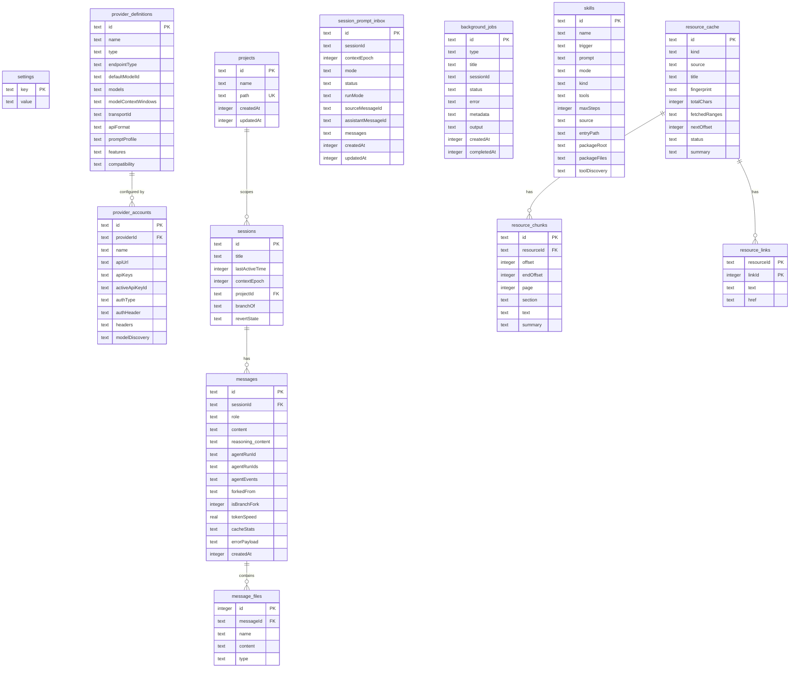

# QuickAI 技术架构文档

> 一个基于 Electron + React + TypeScript 的桌面 AI 助手应用，支持声明式多服务商接入、分支与中断恢复的 ReAct Agent、工作区文件快照回滚、后台任务系统、持久化 SQLite 缓存和 Git 版本化的长期记忆系统。

---

## 目录

1. [项目概览与技术栈](#1-项目概览与技术栈)
2. [Electron 多进程与运行时环境](#2-electron-多进程与运行时环境)
3. [目录结构总览](#3-目录结构总览)
4. [持久化存储与数据库架构 (SQLite)](#4-持久化存储与数据库架构-sqlite)
5. [服务商与模型运行时 (Provider Layer)](#5-服务商与模型运行时-provider-layer)
6. [Git 长期记忆系统 (Durable Memory)](#6-git-长期记忆系统-durable-memory)
7. [模块化工具管理系统 (Dynamic Tools Registry)](#7-模块化工具管理系统-dynamic-tools-registry)
8. [分支与恢复的 Agent 执行引擎 (ReAct Loop)](#8-分支与恢复的-agent-执行引擎-react-loop)
9. [Agent 事件日志与崩溃恢复 (Event Journal)](#9-agent-事件日志与崩溃恢复-event-journal)
10. [工作区文件快照与回滚 (File Snapshot)](#10-工作区文件快照与回滚-file-snapshot)
11. [后台任务系统 (Background Jobs)](#11-后台任务系统-background-jobs)
12. [会话提示队列与上下文纪元 (Steering & Context Epoch)](#12-会话提示队列与上下文纪元-steering--context-epoch)
13. [核心数据流与生命周期](#13-核心数据流与生命周期)
14. [Preload 桥接与安全模型](#14-preload-桥接与安全模型)
15. [Renderer 进程架构与 React Hooks 编排](#15-renderer-进程架构与-react-hooks-编排)
16. [IPC 通道设计与类型系统](#16-ipc-通道设计与类型系统)
17. [多层缓存体系](#17-多层缓存体系)
18. [系统安全模型与纵深防御](#18-系统安全模型与纵深防御)
19. [统一运行时异常管理层](#19-统一运行时异常管理层)
20. [测试体系](#20-测试体系)

---

## 1. 项目概览与技术栈

QuickAI 是一个 **Spotlight 风格的桌面 AI 助手**，通过 `Alt+/` 全局快捷键在屏幕上方居中位置瞬间召唤/隐藏悬浮窗口，同时支持切换为常规可缩放窗口模式（`WindowMode`）。应用支持多种 AI 服务商（opencode、GLM、Kimi/Moonshot、MiMo、DeepSeek、阶跃星辰、Ollama 本地部署及任意自定义 OpenAI 兼容端点），并在底层构建了高度灵活的 ReAct 智能体（Agent）系统。

| 层级         | 技术                      | 用途                                                 |
| ------------ | ------------------------- | ---------------------------------------------------- |
| **桌面容器** | Electron 39               | 窗口位置优化、系统托盘、全局快捷键、进程级隔离       |
| **构建工具** | electron-vite 5           | 统一 main/preload/renderer 三端的快速开发与打包      |
| **持久化层** | better-sqlite3 12         | 基于 SQLite 的关系型本地数据库，WAL 模式保障并发写入 |
| **长期记忆** | Git CLI + Markdown        | 自动 Git 版本化的 Markdown 长期知识库                |
| **文件快照** | Git CLI (`refs/quickai`)  | Agent 改动前后的工作区快照与精确回滚                 |
| **协议扩展** | MCP SDK 1.29              | stdio 传输的 Model Context Protocol 客户端           |
| **前端框架** | React 19 + TypeScript 5.9 | 渲染进程的响应式 UI 状态与事件响应                   |
| **测试**     | Vitest 4                  | 覆盖主进程、共享层与渲染层纯逻辑的单元测试           |

> **模型 SDK 说明**：项目**不依赖任何厂商 SDK**（无 `openai`、无 `@anthropic-ai/*`）。Chat Completions 与 Responses 两套协议的流式传输均为自行实现，见 [§5.4 传输层](#54-传输层与模型调用运行时)。这是为了完全掌控多服务商之间的协议差异与兼容性修补。

---

## 2. Electron 多进程与运行时环境

应用采用 Electron 经典的多进程架构设计，将高风险的原生能力限制在主进程，渲染进程通过 Preload 层的受控接口进行隔离：

```
┌──────────────────────────────────────────────────────────┐
│                     Main Process (Node.js)               │
│                                                          │
│  ┌──────────────┐  ┌───────────────┐  ┌───────────────┐  │
│  │   index.ts   │  │  database/    │  │  agentLoop.ts │  │
│  │  窗口与托盘  │  │ SQLite 持久化 │  │   ReAct 核心  │  │
│  └──────┬───────┘  └───────────────┘  └───────┬───────┘  │
│         │                                     │          │
│  ┌──────▼───────┐  ┌───────────────┐  ┌───────▼───────┐  │
│  │   store.ts   │  │ toolRegistry  │  │  memoryStore  │  │
│  │  KV 存储适配 │  │  动态工具注册 │  │  Git-Markdown │  │
│  └──────────────┘  └───────────────┘  └───────────────┘  │
│                                                          │
│  ┌──────────────┐  ┌───────────────┐  ┌───────────────┐  │
│  │agentEventJrnl│  │agentFileSnapsh│  │backgroundJobMg│  │
│  │  事件日志    │  │  工作区快照   │  │   后台任务    │  │
│  └──────────────┘  └───────────────┘  └───────────────┘  │
│                                                          │
│  ═══════════════ IPC Bridge ═══════════════              │
│         contextBridge.exposeInMainWorld                  │
└─────────────────────────┬────────────────────────────────┘
                          │
                          │  ipcRenderer.invoke / .send / .on
                          │
┌─────────────────────────▼────────────────────────────────┐
│                    Preload Layer                         │
│  index.ts — 暴露 window.api 与 window.electron 对象      │
└─────────────────────────┬────────────────────────────────┘
                          │
                          │  window.api.*
                          │
┌─────────────────────────▼────────────────────────────────┐
│                  Renderer Process (React)                │
│                                                          │
│  ┌──────────────┐  ┌───────────────┐  ┌───────────────┐  │
│  │   App.tsx    │  │  chatStreaming│  │   components/ │  │
│  │ UI 布局与编排│  │ 前端流式解析器│  │  视图组件渲染 │  │
│  └──────┬───────┘  └───────────────┘  └───────┬───────┘  │
│         │                                                │
│  ┌──────▼───────┐  ┌───────────────┐  ┌───────────────┐  │
│  │  useSessions │  │useAutocomplete│  │  useProviders │  │
│  │ 会话与分支管理│  │  命令自动补全 │  │ 服务商/模型配置│  │
│  └──────────────┘  └───────────────┘  └───────────────┘  │
└──────────────────────────────────────────────────────────┘
```

### 2.1 窗口模式与召唤策略

`index.ts` 维护两种窗口形态，由 `WindowMode` 控制：

- **`floating`（Spotlight 悬浮模式）**：780×520 固定尺寸，`alwaysOnTop` + `skipTaskbar`，定位在屏幕水平居中、垂直 15% 处。窗口在启动时即预绘制到屏幕外（`-9999, -9999`）并保持 `showInactive` 状态，召唤时只做**重定位 + 改透明度**，而非 `show()`/`hide()`——后者会触发 Windows 的原生缓动动画造成闪烁。失焦时按 `autoHideOnBlur` 设置自动隐藏（置顶锁定或文件选择器激活时豁免）。
- **`window`（常规窗口模式）**：1080×720 居中，可缩放、可最大化、进任务栏，行为与普通桌面应用一致。

两种模式共用一个 `BrowserWindow` 实例，`setWindowMode()` 负责在两者间迁移并保存/恢复窗口 bounds。关闭窗口（Alt+F4）默认拦截为隐藏，应用常驻托盘。

---

## 3. 目录结构总览

```
src/
├── shared/                       # 三端共享的纯类型定义与无副作用逻辑
│   ├── types.ts                  # 全局类型定义（服务商、消息、事件流、Skill、存储模型等）
│   ├── providerRegistry.ts       # 内置服务商注册表：定义 + 连接默认值 + 运行时画像 + 发现策略
│   ├── providerConfig.ts         # 服务商定义/账号拆分、连接解析与旧格式互转
│   ├── providerProfiles.ts       # 运行时画像解析：特性、兼容性修补、提示词画像推断
│   ├── providerFactory.ts        # 由注册表实例化新服务商配置
│   ├── providerModelDiscovery.ts # 声明式模型发现：URL 拼装与响应字段路径归一化
│   ├── providerModelDiscoveryCache.ts # 模型发现结果的缓存与过期/重试策略
│   ├── providerKeyHelper.ts      # 多 API Key 轮换与激活 Key 解析
│   ├── modelCatalog.ts           # 模型目录归一化与模型级运行时配置
│   ├── agentEvent{Reducer,Replay,Compactor}.ts # Agent 事件流的归约、重放与压缩
│   ├── contextEpoch.ts           # 会话上下文纪元（阻断跨纪元的陈旧写回）
│   ├── runtimeErrors.ts          # 运行时异常的统一分类与规范化
│   └── tokenEstimator.ts / promptDate.ts / skillParser.ts / modelContext.ts
├── preload/                      # 预加载脚本目录（受控桥接）
│   ├── index.ts                  # contextBridge API 暴露实现
│   └── index.d.ts                # window.api 接口类型声明
├── main/                         # Electron 主进程 (Node.js 运行时)
│   ├── index.ts                  # 应用入口：生命周期、托盘、窗口交互及 IPC 调度加载
│   ├── ipc/                      # 独立解耦的 IPC 注册模块目录
│   │   ├── storeIpc.ts           # SQLite 配置适配与技能更新广播
│   │   ├── mcpIpc.ts             # MCP 服务控制、单服务重载与注销
│   │   ├── memoryIpc.ts          # 长期记忆 Git 读写
│   │   ├── cacheIpc.ts           # 会话分叉拷贝与孤立缓存清理
│   │   ├── generationIpc.ts      # 生成控制、提示队列、模型发现、连接诊断、文件回滚
│   │   ├── windowIpc.ts          # 窗口控制（模式切换/最小化/置顶）与控制器注入
│   │   ├── projectIpc.ts         # 工作区项目目录选择
│   │   └── backgroundJobIpc.ts   # 后台任务列举与取消
│   ├── database/                 # SQLite 数据库模块目录
│   │   ├── connection.ts         # 数据库连接初始化与 PRAGMA 性能调优
│   │   ├── schema.ts             # 表结构 DDL 与 ensureColumn 增量列升级
│   │   ├── migration.ts          # 数据库迁移与 JSON 历史数据导入逻辑
│   │   ├── providerStore.ts      # 服务商定义/账号的拆分持久化与旧表回迁
│   │   ├── sessionPromptStore.ts # 会话提示收件箱（steering / queue）
│   │   ├── backgroundJobStore.ts # 后台任务记录持久化与修剪
│   │   └── *Store.ts             # sessionStore, settingsStore, skillStore, projectStore, resourceStore
│   ├── store.ts                  # 旧版 store 的适配层，透明桥接至 SQLite 数据库
│   ├── aiClient.ts               # Chat 模式入口，调用 LLM 完成标准会话
│   ├── paths.ts                  # 集中管理 ~/.quickai 等本地目录及路径解析
│   ├── resourceCache.ts          # 网络内容抓取的磁盘关系缓存管理
│   ├── logger.ts                 # 主进程文件和控制台日志记录器
│   ├── mcpManager.ts             # 连接和管理外部 MCP 服务的核心（含单服务重载）
│   ├── skillManager.ts           # 自定义技能包导入、目录监听与运行管理
│   ├── web/                      # 网络服务提取层
│   │   ├── urlSafety.ts          # SSRF 安全防护与本地 IP 拦截
│   │   ├── htmlExtract.ts        # 网页 HTML 去冗余提取与 Markdown 转换
│   │   └── searchParsers.ts      # 多搜索引擎返回结果爬取解析
│   ├── memory/                   # Durable Memory 长期记忆模块
│   │   ├── memoryStore.ts        # memories/ 目录下 Markdown 文件的操作和自动索引
│   │   └── memoryGit.ts          # Git 自动跟踪提交与仓库初始化
│   ├── tools/                    # 模块化原子化工具箱目录（120+ 文件）
│   │   ├── types.ts              # 工具与执行上下文的 TypeScript 类型定义
│   │   ├── registry.ts           # 动态工具注册中心与 Bracket Proxy 代理
│   │   ├── file*Tool.ts          # 独立拆分的文件写/读/删除/重命名等原子工具
│   │   ├── codeSymbol*.ts        # 代码符号扫描与选取（结构化读取源码）
│   │   ├── web*Tool.ts           # 网页爬取、级联网络搜索等原子工具
│   │   ├── memory*Tool.ts        # 读、写、清理长期记忆的原子工具
│   │   ├── skill*Tool.ts         # 自定义技能创建、移除、安装与校验的原子工具
│   │   ├── backgroundShell.ts    # 后台 shell 任务的启动与输出收集
│   │   └── subagentTool.ts       # 派生独立沙箱子 Agent（含后台模式）
│   └── agent/                    # Agent 引擎目录（110+ 文件）
│       ├── index.ts              # 引擎对外的统一导出入口
│       ├── agentLoop.ts          # Agent 顶层推理主循环（纯编排）
│       ├── agentRunPreparation.ts# 入参校验、切片装载、分支提示注入
│       ├── agentRunLifecycle.ts  # 运行上下文创建、清单登记与终态落盘
│       ├── AgentRunContext.ts    # Agent 运行时状态容器（工具大输出缓冲等）
│       ├── agentEvent{Stream,Journal,Recovery}.ts # 事件发射、落盘与崩溃恢复
│       ├── agentFileSnapshot.ts  # 工作区 Git 快照、差异预览与回滚
│       ├── backgroundJobManager.ts / background*Delivery.ts # 后台任务与结果回投
│       ├── messageBuilder.ts     # 系统提示词编排与上下文摘要拼接
│       ├── contextManager.ts     # 上下文窗口智能截断与裁剪管理器
│       ├── contextCompactor.ts   # /compact 主动压缩
│       ├── staleToolResultCompaction.ts # 上下文压力下的陈旧工具结果压缩
│       ├── cache{ShapeDiagnostics,PriorityContext}.ts # 提示缓存形状诊断与保留策略
│       ├── model{Transport,Adapter,RequestTarget,ResponseNormalizer,PromptProfile}.ts # 传输与适配
│       ├── call{Model,ChatCompletionsModel,ResponsesModel}.ts # 两套协议的流式实现
│       ├── permissionManager.ts  # 等待前端异步审批的 Promise 等待逻辑
│       ├── constitution.ts       # 静态安全规则宪法，动态升降授权级别
│       ├── commandSafety.ts / pathPolicy.ts # 词法命令分类器与路径包含性策略
│       ├── loopGuard.ts          # 熔断守卫：防止重复调用与连续报错陷入死循环
│       ├── *Runner.ts            # 解耦的任务驱动器 (modelTurnRunner, toolTurnRunner,
│       │                         #   toolBatchRunner, forcedFinalTurnRunner, subagentRunner)
│       ├── toolStep*.ts          # 工具流管道 (Processor, Applicator, Finalizer, Presentation)
│       └── run{Checkpoint,Manifest}.ts # 切片还原与运行清单管理
└── renderer/                     # Renderer 进程 (React 前端)
    └── src/
        ├── main.tsx              # React 挂载入口
        ├── App.tsx               # UI 状态机骨架与全局弹窗管理
        ├── contexts/             # ToastContext（状态/动作双 Context 拆分）
        ├── features/             # 内聚核心业务领域逻辑层
        │   ├── chat/
        │   │   ├── apiMessageBuilder.ts       # API 消息组装与 /compact 上下文剪枝
        │   │   ├── sessionMutationService.ts  # 新会话首发回写与 fork 逻辑事务
        │   │   ├── sessionPromptQueue.ts      # 生成中追加提示的 steer / queue 队列
        │   │   ├── sessionRevertService.ts    # 时间线回退与工作区文件还原编排
        │   │   ├── useVirtualizedMessages.ts  # 长会话消息虚拟化
        │   │   ├── useMessageNavigation.ts    # 消息导航与 minimap
        │   │   └── useAgentMessageViewModel.ts# 单条消息呈现状态与计时的 ViewModel
        │   ├── errors/           # 运行时异常的文案映射与消息加工
        │   └── mcp/              # MCP 管理面板逻辑
        ├── hooks/                # 响应式逻辑 Hook
        │   ├── useSessions.ts    # 会话列表增删改查及缓存自动修剪
        │   ├── useChatCompletion.ts # 对话调度 React 绑定驱动层
        │   ├── useProviders.ts   # 多服务商、模型发现、连接诊断与工具权限配置
        │   ├── chatStreaming.ts  # 处理 onChatChunk 通信的前端流式逻辑封装
        │   ├── useSmoothStreamText.ts # 流式文本的平滑渲染节流
        │   └── sessionBranching.ts # 创建分叉会话、提取运行轨迹等分支工具包
        ├── components/           # UI 视图组件
        │   ├── MessageBubble.tsx # 单条消息气泡，消费 ViewModel 产出的稳定呈现状态
        │   ├── SettingsView.tsx  # 设置面板骨架
        │   ├── ProviderEditor.tsx / ProviderList.tsx / ModelsModal.tsx # 服务商与模型配置
        │   ├── BackgroundTaskManagerModal.tsx # 后台任务管理面板
        │   ├── AgentFileRevertModal.tsx / SessionRevertModal.tsx # 文件与时间线回滚确认
        │   └── SubagentRunPanel.tsx / TaskPanel.tsx / ContextPanel.tsx
        └── utils/
            ├── messageFormat.tsx # Markdown + KaTeX + 代码高亮渲染器
            ├── codeHighlight.tsx # 轻量自研代码高亮
            └── providerPresets.ts / providerHeaderEditor.ts # 服务商预设与请求头编辑
```

---

## 4. 持久化存储与数据库架构 (SQLite)

在之前的版本中，QuickAI 使用 JSON 文件进行扁平化存储。现已全面重构成基于本地 SQLite 关系型数据库的模块化架构。

### 4.1 模块化数据库架构 —— [src/main/database/](file:///d:/Git/Quick%20Ai/src/main/database)

数据库逻辑不再堆叠在单文件中，而是采用 Repository 模式解耦为以下子模块：

- **连接配置管理器 —— [connection.ts](file:///d:/Git/Quick%20Ai/src/main/database/connection.ts)**：
  负责数据库首次初始化，定位 `{userData}/quickai.db` 文件，并应用高性能 SQLite Pragma 优化：
  - `journal_mode = WAL`：开启 Write-Ahead Logging 模式，提供高并发读写性能。
  - `foreign_keys = ON`：强制启用外键物理约束。
  - `synchronous = NORMAL`：在安全与磁盘 I/O 间取得平衡。
- **结构定义与表定义 —— [schema.ts](file:///d:/Git/Quick%20Ai/src/main/database/schema.ts)**：
  定义关系数据库各张表的 DDL，并通过 `ensureColumn()` 对既有安装执行**幂等的增量列升级**（避免为每次字段新增编写迁移脚本）。
- **数据迁移与导入引擎 —— [migration.ts](file:///d:/Git/Quick%20Ai/src/main/database/migration.ts)**：
  处理版本迭代时的表结构平滑迁移，以及 `migrateFromJson()`（在数据库为空时读取旧的 `quickai_store.json` 进行一次性原子导入，并生成 `.bak` 备份）。
- **业务逻辑持久化仓库 (Repositories)**：
  - [settingsStore.ts](file:///d:/Git/Quick%20Ai/src/main/database/settingsStore.ts)：全局 KV 配置存储。
  - [providerStore.ts](file:///d:/Git/Quick%20Ai/src/main/database/providerStore.ts)：服务商**定义**与**账号**的拆分持久化，兼容旧 `providers` 单表回迁（见 [§5.2](#52-定义与账号的拆分持久化)）。
  - [sessionStore.ts](file:///d:/Git/Quick%20Ai/src/main/database/sessionStore.ts)：会话及其下层级联消息（Messages & Files）的管理仓库。
  - [sessionPromptStore.ts](file:///d:/Git/Quick%20Ai/src/main/database/sessionPromptStore.ts)：生成期间追加提示的收件箱队列（见 [§12](#12-会话提示队列与上下文纪元-steering--context-epoch)）。
  - [backgroundJobStore.ts](file:///d:/Git/Quick%20Ai/src/main/database/backgroundJobStore.ts)：后台任务记录与跨重启状态恢复。
  - [skillStore.ts](file:///d:/Git/Quick%20Ai/src/main/database/skillStore.ts)：AI 技能包元数据和资源路径存储。
  - [projectStore.ts](file:///d:/Git/Quick%20Ai/src/main/database/projectStore.ts)：多工作空间项目属性持久化。
  - [resourceStore.ts](file:///d:/Git/Quick%20Ai/src/main/database/resourceStore.ts)：网页抓取及 PDF 读入的切片级缓存管理器。

### 4.2 数据库 Schema 结构



### 4.3 JSON 数据自动迁移机制

如果数据库为空而本地存在旧格式的 `quickai_store.json` 与 `resources/` 目录，[migration.ts](file:///d:/Git/Quick%20Ai/src/main/database/migration.ts) 中的 `migrateFromJson()` 会自动解析旧数据，通过批量准备语句 (Prepared Statements) 将数据转换并插入到 SQLite 对应的表中，成功后将旧的 JSON 文件重命名为 `.bak` 文件。

### 4.4 KV 桥接适配器 —— [store.ts](file:///d:/Git/Quick%20Ai/src/main/store.ts)

为了不破坏已有的 IPC 调用逻辑，[store.ts](file:///d:/Git/Quick%20Ai/src/main/store.ts) 导出了一个 `FileStore` 类，其 `get(key)` 和 `set(key, val)` 接口保持原样，但在内部透明地转换为调用 `database` 各仓库中的 `loadSettings()`, `saveSettings()`, `loadSessions()`, `saveSessions()`, `loadSkills()`, `saveSkills()` 等关系型数据库读写逻辑。

---

## 5. 服务商与模型运行时 (Provider Layer)

多服务商适配是本项目最复杂的横切关注点之一：同为「OpenAI 兼容」的端点，在流式 usage 上报、`tool_choice` 支持、推理内容字段、空 tool_calls 处理上都存在差异。该层的设计目标是把这些差异**收敛为声明式数据**，而不是散落在调用代码里的 `if (type === 'glm')`。

整体分为四段职责：

```
  providerRegistry.ts            providerConfig.ts           providerProfiles.ts        modelTransport.ts
 ┌────────────────────┐        ┌───────────────────┐       ┌──────────────────┐      ┌─────────────────┐
 │ 内置注册表(声明式)  │  ───►  │ 定义 / 账号拆分    │ ───► │ 逐层合并解析      │ ───► │ 协议驱动分发     │
 │ definition         │        │ ProviderDefinition│       │ 注册表 → 服务商   │      │ chat-completions│
 │ accountDefaults    │        │ ProviderAccount   │       │  → 模型推断      │      │ responses       │
 │ runtime profile    │        │ ResolvedConnection│       │  → 用户覆盖      │      │ (可注册扩展)     │
 │ modelDiscovery     │        │                   │       │                  │      │                 │
 └────────────────────┘        └───────────────────┘       └──────────────────┘      └─────────────────┘
```

### 5.1 内置注册表 —— [providerRegistry.ts](file:///d:/Git/Quick%20Ai/src/shared/providerRegistry.ts)

每个内置服务商是一条 `ProviderRegistration`，包含四块互不耦合的声明：

| 字段              | 内容                                                                                  | 示例                                                                   |
| ----------------- | ------------------------------------------------------------------------------------- | ---------------------------------------------------------------------- |
| `definition`      | 类型、显示名、内置模型列表、默认模型                                                  | `type: 'glm'`, `defaultModel: 'glm-4.5-air'`                           |
| `accountDefaults` | 默认 Base URL、鉴权方式、默认请求头                                                   | `apiUrl: 'https://open.bigmodel.cn/api/paas/v4'`, `authType: 'bearer'` |
| `runtime`         | 端点类型、API 格式、传输 ID、支持的传输集合、提示词画像、**特性开关**、**兼容性修补** | GLM: `streamUsage: false` + `omitToolChoice: true`                     |
| `modelDiscovery`  | 模型发现的端点路径与响应字段候选路径                                                  | `endpointPath: 'models'`, `idPaths: ['id','name','model']`             |

`createProviderRuntimeProfile()` 提供 OpenAI 兼容的默认画像，各服务商只声明**差异部分**。目前内置 8 家：`opencode`、`glm`、`kimi`、`mimo`、`deepseek`、`ollama`、`step`（阶跃星辰）、`custom`（自定义端点）。

**兼容性修补开关**（`ResolvedModelCompatibilityProfile`）：

- `stripReasoningContent`：请求回传时剥离 `reasoning_content` 字段
- `stripToolMessageName`：移除 tool 消息上的 `name`（部分端点会 400）
- `normalizeToolCallContent`：归一化 tool_call 的 content 结构
- `stripEmptyToolCalls`：剔除空的 `tool_calls` 数组
- `omitToolChoice`：不下发 `tool_choice`（GLM / Ollama 不支持）
- `reasoningFormat`：推理内容的解析风格（如 `deepseek-style`）

`modelCompatibilityRules` 支持**按模型名子串**追加修补，例如阶跃星辰的 `flash` / `router` / `reason` 系列自动套用 `deepseek-style` 推理格式。

`validateProviderRegistrations()` 是一个结构性自检：默认模型必须在模型列表内、默认传输必须在支持集合内、`apiFormat` 必须与传输匹配、并行工具调用不能在无工具调用能力时开启、发现策略字段不得为空。该函数同时用于启动诊断与回归测试。

### 5.2 定义与账号的拆分持久化

早期 `ApiProvider` 是一个把「这家服务商是什么」和「我这台机器怎么连它」混在一起的大对象。[providerConfig.ts](file:///d:/Git/Quick%20Ai/src/shared/providerConfig.ts) 将其拆为两个正交实体：

- **`ProviderDefinition`（静态）**：类型、模型目录、上下文窗口、传输、特性、兼容性、提示词画像 → 落 `provider_definitions` 表
- **`ProviderAccount`（可变）**：Base URL、多 API Key 与激活 Key、鉴权方式与自定义请求头、模型发现缓存 → 落 `provider_accounts` 表（`providerId` 外键级联）

两者通过 `splitProviderConfigurations()` / `composeProviderConfigurations()` 双向转换，渲染层仍消费合并后的 `ApiProvider` 视图，因此这次拆分对 UI 是透明的。`hasLegacyConnectionParity()` 在迁移期充当断言：确保新的 `resolveProviderConnection()` 与旧的 `getActiveProviderApiKey()` 解析出同一个凭证。

`resolveProviderSelection(provider, modelId)` 是 UI/运行时的**唯一收口**，一次性解析出 `{ definition, account, connection, model }` 四元组交给 Agent 层，避免下游反复读取零散字段。

### 5.3 声明式模型发现与缓存

- **发现 —— [providerModelDiscovery.ts](file:///d:/Git/Quick%20Ai/src/shared/providerModelDiscovery.ts)**：不假设响应必然是 OpenAI 的 `{data: [...]}` 结构。`collectionPaths`、`idPaths`、`contextWindowPaths`、`capabilityPaths` 都是**候选路径数组**，按序尝试首个命中者；`'$'` 表示响应根即数组。因此新增一个非标准端点通常只需要补一条路径，而不必写解析代码。同时把杂乱的能力标记（`image`/`images`/`vision`、`tool_calls`/`function_calling`）归一化为 `ModelCapability`。
- **缓存 —— [providerModelDiscoveryCache.ts](file:///d:/Git/Quick%20Ai/src/shared/providerModelDiscoveryCache.ts)**：发现结果按 `sourceUrl` 持久化在账号记录里，有效期 **6 小时**（`MODEL_DISCOVERY_CACHE_MAX_AGE_MS`）；失败后 **5 分钟**内不重试（`MODEL_DISCOVERY_ERROR_RETRY_DELAY_MS`），避免配置页反复打无效请求。
- **连接诊断**：`test-provider-connection` 通道对当前账号做一次探活，返回结构化的 `ProviderConnectionTestResult` 供 UI 直接展示失败原因（而不是抛一个裸异常字符串）。

### 5.4 传输层与模型调用运行时

[modelTransport.ts](file:///d:/Git/Quick%20Ai/src/main/agent/modelTransport.ts) 维护一张传输注册表，把协议实现与调用方解耦：

| 传输 ID                   | API 格式           | 实现                                                                                                |
| ------------------------- | ------------------ | --------------------------------------------------------------------------------------------------- |
| `openai-chat-completions` | `chat-completions` | [callChatCompletionsModel.ts](file:///d:/Git/Quick%20Ai/src/main/agent/callChatCompletionsModel.ts) |
| `openai-responses`        | `responses`        | [callResponsesModel.ts](file:///d:/Git/Quick%20Ai/src/main/agent/callResponsesModel.ts)             |

`registerModelTransport()` 是为未来接入原生协议驱动预留的扩展点（重复注册会抛错，返回值为注销函数）。围绕传输层的配套模块：

- `modelRequestTarget.ts`：由连接信息拼装最终 URL 与鉴权头
- `modelAdapter.ts`：按兼容性画像对出站消息做修补
- `modelResponseNormalizer.ts`：把两套协议的响应归一化为同一内部形状
- `modelEvents.ts` / `modelCallRuntime.ts`：流式事件解析与调用运行时
- `modelPromptProfile.ts`：按提示词画像（`claude` / `gemini` / `gpt` / `reasoning` / `default`）调整系统提示措辞

---

## 6. Git 长期记忆系统 (Durable Memory)

为了防止模型会话因为上下文截断而丧失对全局背景、工作路径或用户核心偏好的认知，应用设计了独立于会话上下文的长期记忆系统。

### 6.1 记忆目录结构 (`~/.quickai/memories`)

长期记忆库由以下核心 Markdown 文件组成，由主进程的 [memoryStore.ts](file:///d:/Git/Quick%20Ai/src/main/memory/memoryStore.ts) 进行维护：

- `always.md` (常态注入内存)：每一轮任务都会强制拉取并拼接在系统提示词的最上方，适合记录全局安全边界、用户语言偏好。
- `memory_summary.md` (按需索引表)：保存由 MEMORY.md 的所有 `Task Group` 提取的条目目录。在任务初始化时会被注入到 System Prompt，告诉模型当前有哪些大记忆组可以调用。
- `MEMORY.md` (按需知识库)：按照 `# Task Group: <名称>` 进行段落划分的本地 Markdown 知识库。模型可以通过 `read_memory(target="xxx")` 按需提取。
- `raw_memories.md` (原始记忆沉淀)：追加写入的原始经验记录，供系统重建或审计。
- `rollout_summaries/` (任务轨迹追溯)：记录历史任务执行成功或失败的溯源日志（以日期命名）。

> 路径解析集中在 [paths.ts](file:///d:/Git/Quick%20Ai/src/main/paths.ts)。`QUICKAI_HOME` 可整体重定向应用根目录（测试用），`QUICKAI_WORKSPACE_ROOT` 仅覆盖工作区路径。两者都经 `readEnvPathOverride()` 过滤，空串与字面量 `"undefined"` / `"null"` 一律视为未设置——避免误写的环境变量把所有磁盘根目录重定向到相对路径。

### 6.2 自动 Git 版本化控制 —— [memoryGit.ts](file:///d:/Git/Quick%20Ai/src/main/memory/memoryGit.ts)

每次模型通过 `write_memory` 或 `delete_memory` 修改上述 Markdown 文件时，[memoryStore.ts](file:///d:/Git/Quick%20Ai/src/main/memory/memoryStore.ts) 会在写入完成后立即执行 Git 命令：

1. 检查本地 `.git` 目录是否存在。如果不存在则执行 `git init` 自动初始化仓库，并预置本地提交邮箱为 `memory@quickai.local`。
2. 调用 `git add -A` 暂存所有变化。
3. 调用 `git commit -m "memory: write task group ..."` 固化记录，确保每一次记忆改动都可查、可做差异分析 (Diff)、可做历史回滚。
4. **容错机制**：由于 Git 依赖于系统命令，如果用户机器未安装 Git 命令行工具，底层会自动退避为"无版本控制"的纯文件读写，保证记忆功能依旧可用。

---

## 7. 模块化工具管理系统 (Dynamic Tools Registry)

随着工具量级的提升，QuickAI 从早期单文件的硬编码注册升级为模块化、动态可插拔的工具设计。

### 7.1 工具定义规范 —— [types.ts](file:///d:/Git/Quick%20Ai/src/main/tools/types.ts)

每个工具都必须实现 `ToolDefinition` 接口：

```typescript
export interface ToolDefinition {
  name: string
  title: string
  description: string
  tags: string[]
  category: 'web' | 'file' | 'shell' | 'memory' | 'system'
  risk: 'low' | 'medium' | 'high'
  implemented: boolean
  discoverable: boolean
  parameters: {
    type: 'object'
    properties: Record<string, any>
    required?: string[]
  }
  execute: (
    args: ToolArgs,
    ctx: ToolExecutionContext
  ) => Promise<{
    resultForModel: string
    resultForUi: ToolResultUi
  }>
}
```

工具层通过 `AgentHostActions` 回调接口与 Electron 交互（请求用户选择、聚焦窗口、投递后台结果），**不持有 `BrowserWindow` 引用**。这是整个 `tools/` 目录能在纯 Node 环境下直接单测的根本原因。

### 7.2 动态工具注册中心 —— [registry.ts](file:///d:/Git/Quick%20Ai/src/main/tools/registry.ts)

工具不再集中于几个粗粒度的类别大文件中，而是被彻底原子化拆分为存放于 `src/main/tools/` 目录下的独立专责文件（如 `fileReadTool.ts`、`webSearchTool.ts`、`subagentTool.ts` 等），遵循单一职责原则。

#### 核心工具模块划分：

- **文件操作工具（File Tools）**：
  - `fileReadTool.ts` / `fileWriteTool.ts` / `fileEditTool.ts` / `multiEditTool.ts` / `fileDeleteTool.ts`：读写删改。
  - `fileCopyTool.ts` / `fileMoveTool.ts` / `directoryCreateTool.ts`：复制、移动和目录创建。
  - `workspaceListFilesTool.ts` / `workspaceSearchTool.ts` / `workspaceGlob.ts`：工作空间文件列举、正则和 Glob 检索。
  - `codeSymbolTool.ts` 及其扫描/选取子模块：按符号结构读取源码，避免整文件灌入上下文。
- **网络操作工具（Web Tools）**：
  - `webFetchTool.ts` / `webSearchTool.ts` / `webPageTools.ts`：网页抓取、级联搜索与页面二次检索。
- **系统与通知工具（System Tools）**：
  - `notifyTool.ts` / `inspectEnvironmentTool.ts` / `environmentProbe.ts`：通知系统与本地运行时环境检测。
  - `taskTool.ts`：用于 Agent 追踪计划分解的步骤记录。
  - `userChoice.ts`：向用户发起结构化选择请求并阻塞等待。
  - `reminderTools.ts`：运行期自我提醒。
- **Shell 工具**：
  - `shell.ts` / `shellExecutor.ts` / `shellEncoding.ts`：命令执行与跨平台编码处理。
  - `backgroundShell.ts`：长时命令转入后台任务，输出持久化后异步回投。
- **长期记忆管理工具（Memory Tools）**：
  - `memoryReadTools.ts` / `memoryWriteTools.ts` / `memoryActionTools.ts`：长期知识库与行动历史记录的管理。
- **子 Agent 与运行时（Subagent & Core Tools）**：
  - `subagentTool.ts`：派生独立沙箱子 Agent（支持前台阻塞与后台异步两种模式）。
  - `toolOutputTools.ts` / `cachedResourceTools.ts`：大容量工具输出和资源抓取缓存检索。
- **技能生命周期管理（Skill Tools）**：
  - `skillCreateTool.ts` / `skillInstallTool.ts` / `skillRemoveTool.ts` / `skillListTool.ts` / `skillValidationTool.ts`：自定义技能包的热插拔管理与格式校验。

主进程启动时会利用 `ToolRegistryImpl` 注册所有内置模块。为了兼容旧版代码直接使用 `ToolRegistry[name]` 的属性语法访问，[registry.ts](file:///d:/Git/Quick%20Ai/src/main/tools/registry.ts) 暴露了一个 Proxy 代理。当调用 `ToolRegistry[name]` 时，代理会将调用路由至 `ToolRegistryImpl.get(name)`。同时，它配合 [registryView.ts](file:///d:/Git/Quick%20Ai/src/main/tools/registryView.ts) 支持对动态加载的工具进行元数据审查与迭代；`toolDeclarationCache.ts` 依据注册表修订号缓存工具声明，避免每步重复序列化。

### 7.3 MCP 连接、重载与执行超时机制

为了防御不稳定的外部 MCP 服务可能导致的子进程或连接悬挂风险，`McpManager` 引入了细粒度的超时保护与主动销毁逻辑：

- **读取全局 `timeouts` 调度配置**：在主进程 reload 时读取配置文件的顶层 `timeouts` 声明，包含 `connect_timeout` (连接与工具声明检索超时) 和 `execute_timeout` (单个工具执行超时)。
- **双向连接与列表请求超时熔断**：应用将 `client.connect` 和 `client.listTools` 统一包裹在 `withTimeout` 竞速中（默认为 10s）。一旦发生超时或网络无法连通，将触发该 Server 的彻底注销。
- **运行期间的 CallTool 超时熔断**：调用 `client.callTool` 时应用会对其添加 `execute_timeout` 的上限判定（默认为 30s）。若工具执行卡死超时，将立刻抛出超时异常反馈给大模型，确保管线不被阻塞。
- **单服务热重载 (`mcp-reload-server`)**：支持只重启某一个 MCP Server 而不影响其余连接，用于用户修改单条配置后的快速生效。
- **靶向 Server 关闭与卸载机制 (`cleanupServer`)**：在任何阶段（包括连接与工具运行）检测到超时后，McpManager 会独立针对故障 Server 执行清理事务：
  1. 调用 `client.close()` / `transport.close()` 触发底层的 stdio 连接切断并退出相应的 child process 句柄。
  2. 从 `registeredToolNames` 内存集中识别并批量注销该 Server 下注册在 QuickAI Registry 中的所有 `mcp_{server}_{tool}` 工具。
  3. 将该 MCP 服务在 UI 的状态字典中设置为 `failed`，并附带确切的 timeout 报错信息，保障悬挂进程和僵死工具被及时清理。

---

## 8. 分支与恢复的 Agent 执行引擎 (ReAct Loop)

Agent 执行引擎基于 ReAct 循环，解耦为了高度模块化的管线处理器（Pipeline Processors），以提供对会话中断（Interrupt）、切片保存（Checkpointing）、分支（Branching）和状态复苏（Resuming）的完整支持。

[agentLoop.ts](file:///d:/Git/Quick%20Ai/src/main/agent/agentLoop.ts) 本身只负责**编排**（约 600 行）：所有实质逻辑都下沉到单一职责的协作模块中。

### 8.1 Agent 执行管线拆解与生命周期

当 Agent 被触发时，它将依次流经以下由 [src/main/agent/](file:///d:/Git/Quick%20Ai/src/main/agent) 驱动的处理阶段：

1.  **准备阶段（Run Preparation）**：
    由 `agentRunPreparation.ts` 校验最大步数上限、装载 Resume 切片、注入分支提示；`agentRunLifecycle.ts` 创建运行上下文并登记运行清单；`runUsageTracker.ts` 开启本次运行的 Token 及调用计数统计；`beginAgentFileSnapshot()` 记录工作区基线快照。
2.  **大模型思考规划驱动（Model Turn Runner）**：
    由 `modelTurnRunner.ts` 发起流式 LLM 调用，经 `modelTransport.ts` 路由给对应协议实现，由流式解析器实时输出推理内容与工具调用规划（Tool Calls）。调用前会先做上下文裁剪（`staleToolResultCompaction` → `trimMessagesToFit`）并采集提示缓存形状（`cacheShapeDiagnostics`）。
3.  **安全审查与授权（Permission Guard）**：
    提取规划中的工具参数，交由 `constitution.ts`、`commandSafety.ts` 和 `pathPolicy.ts` 进行路径逃逸和高危 Shell 命令分析，必要时通过 `permissionManager.ts` 抛出 IPC 挂起 Promise，等待前端操作审批。
4.  **工具批量执行器（Tool Turn Runner）**：
    由 `toolTurnRunner.ts` 进行工具调度。当有多项无依赖的工具调用时，由 `toolBatchRunner.ts` 开启并发执行，通过 `preparedToolExecutor.ts` 分发具体的本地原子工具（`*Tool.ts`）并回收结果。
5.  **步骤落地与清洗管道（Step Processor & Applicator）**：
    - `toolStepProcessor.ts`：将执行结果与原始调用请求封装为完整的步骤块。
    - `toolStepApplicator.ts`：处理可能发生的文件系统与变量状态变更应用。
    - `toolStepFinalizer.ts`：执行步骤的最终结算，并进行 `persistCheckpoint` 数据落盘。
    - `toolStepPresentation.ts`：实时将最终步骤的视觉化结果推送回 React 渲染进程进行展示。
6.  **收尾（Finalization）**：
    工具轮结束但未产出最终答案时（触顶 `maxSteps` 或 LoopGuard 熔断），`forcedFinalTurnRunner.ts` 强制索取一次尽力而为的最终回答；随后 `finalizeFileSnapshot()` 汇总本次运行的文件变更并作为 `file_changes` 事件发出。

### 8.2 Agent 切片与清单体系

在管线执行的每个 Turn 结束时，引擎会持久化保存以下关键数据，以支持分支切换和崩溃恢复：

#### 1. 运行时切片 —— [runCheckpoint.ts](file:///d:/Git/Quick%20Ai/src/main/agent/runCheckpoint.ts)

切片保存了单步执行完毕时的全部关键状态，写入到磁盘：`{userData}/run_checkpoints/{sessionId}/{reqId}.json`。

```typescript
export interface RunCheckpoint {
  version: number
  sessionId: string // 关联会话ID
  reqId: string // 关联运行ID
  updatedAt: number
  step: number // 当前执行的步数
  messages: ChatCompletionMessage[] // 当前全量历史消息
  activeTools: string[] // 当前已发现激活的工具
  lastCompletedCallId?: string
  ambiguousActions?: AmbiguousAction[] // 存留的执行状态模糊的动作
}
```

> `cloneMessagesForCheckpoint()` 在落盘前会剔除**瞬态系统提示**（记忆上下文提示、历史遗留的 RESUME MODE 提示），确保切片存的是稳定的对话主干。

#### 2. 执行清单 —— [runManifest.ts](file:///d:/Git/Quick%20Ai/src/main/agent/runManifest.ts)

清单记录了一个运行过程中的追踪信息，存盘路径为 `{userData}/run_manifests/{sessionId}/{reqId}.json`：

```typescript
export interface AgentRunManifest {
  version: number
  runId: string
  sessionId: string
  sourceMessageId?: string // 触发该 Run 的 User 消息 ID
  assistantMessageId?: string // 本次 Run 写入的 Assistant 消息 ID
  parentRunId?: string // 如果是 Resume，父级 Run 的 ID
  branchOf?: { sessionId: string; messageId: string; runId?: string } // 分支来源
  status: 'running' | 'completed' | 'failed' | 'cancelled' | 'max_steps'
  actionCallIds: string[] // 调用过的所有 action id 列表
  resourceIds: string[] // 涉及的全部 fetched 网页缓存ID
  sideEffects: SideEffectEntry[] // 发生的副作用列表（如文件写入、shell执行）
}
```

清单同时承载文件快照引用，是 [§10 文件回滚](#10-工作区文件快照与回滚-file-snapshot) 的索引来源。

### 8.3 中断与在线恢复机制 (Resume Mode)

当 Agent 由于异常（网络瞬断、大模型限流、或用户手动取消）中断时，UI 气泡会渲染 **"恢复（Resume）"** 按钮。

1. 用户点击恢复后，前端携带该步骤的 `agentRunId` 发送 `start-chat-completion` 请求。
2. 主进程拦截恢复信号，由 `agentRunPreparation.ts` 重新加载对应 Run 缓存的 `RunCheckpoint` 切片，将执行状态精确恢复至中断步数。
3. **恢复不再注入 `[RESUME MODE]` 系统提示**。切片消息被原样复用，因此恢复后的首个模型请求与被中断的那一步**逐字节一致**，可获得 100% 的提示缓存命中。原提示的防重复职责已由三重现有机制覆盖：模型能在历史里看到已完成的工具结果、`LoopGuard` 的重复调用检测、以及 `AgentRunContext` 的 `hasExecuted` 去重。

> 与之相对，**分支派生**仍会注入 `[BRANCH MODE]` 提示（`buildBranchForkPrompt`）——因为分支的语义是"对话回到了过去，但磁盘没有"，必须显式告知模型不要假设工作区状态已回滚。

### 8.4 会话分支派生与重构 (Session Branching)

当用户在历史旧消息上点击编辑或重新生成时，系统会触发分支分叉：

1. **状态复制与分叉**：
   渲染进程利用 [sessionBranching.ts](file:///d:/Git/Quick%20Ai/src/renderer/src/hooks/sessionBranching.ts) 创建带有 `branchOf` 标志的全新 Session，克隆当前时间戳前的所有历史消息，并将编辑后内容作为最新的 User 消息。
2. **持久化缓存分叉 (Fork Caches)**：
   主进程接收 `fork-session-caches` 请求，将父 Session 中该时间节点前所有的 `RunCheckpoint` 切片、行动日志（`actionLog`）、运行清单与**事件日志**成套克隆至新 Session 目录（返回值分别报告 `actions` / `checkpoints` / `manifests` / `events` 四类的拷贝数量）。分支 Session 将无缝继承先前的运行历史，使模型在检索过去操作时免受重复请求与执行的困扰。

---

## 9. Agent 事件日志与崩溃恢复 (Event Journal)

Agent 运行期间产生的事件流（推理增量、工具调用、步骤进度、最终答案）此前只经 IPC 推送给渲染层，一旦应用在生成中途崩溃或被强杀，这段轨迹就永久丢失，UI 上留下一个卡在 running 状态的僵尸气泡。

[agentEventJournal.ts](file:///d:/Git/Quick%20Ai/src/main/agent/agentEventJournal.ts) 为此建立了与 IPC 推送并行的落盘通道。

### 9.1 写入路径与保护阈值

`createAgentEventJournalWriter()` 返回的 writer 被挂在 `createAgentEventStream()` 的发射钩子上，每个事件**同时**做两件事：追加进日志、经 IPC 推送。写入端设有多重保护：

| 常量                                                      | 值             | 作用                                   |
| --------------------------------------------------------- | -------------- | -------------------------------------- |
| `FLUSH_INTERVAL_MS`                                       | 150ms          | 批量刷盘间隔，避免高频流式事件打爆磁盘 |
| `MAX_EVENTS`                                              | 1500           | 单次运行的事件条数上限                 |
| `MAX_JOURNAL_CHARS`                                       | 5 MB           | 单个日志文件的字符上限                 |
| `MAX_EVENT_CHARS`                                         | 256 KB         | 单条事件的字符上限                     |
| `MAX_VALUE_DEPTH` / `MAX_ARRAY_ITEMS` / `MAX_OBJECT_KEYS` | 10 / 200 / 200 | 序列化时的结构深度与广度截断           |

敏感字段在序列化阶段替换为 `[REDACTED]`，与 ActionLog 的脱敏策略一致。

### 9.2 崩溃恢复与事件重放

- **恢复 —— [agentEventRecovery.ts](file:///d:/Git/Quick%20Ai/src/main/agent/agentEventRecovery.ts)**：应用启动时扫描仍处于 `running` 状态的日志，将其判定为异常中断，写入终态错误 `Agent run was interrupted before the application exited.`，使 UI 能把僵尸气泡渲染为可恢复的失败态。
- **重放与归约 —— [agentEventReducer.ts](file:///d:/Git/Quick%20Ai/src/shared/agentEventReducer.ts) / [agentEventReplay.ts](file:///d:/Git/Quick%20Ai/src/shared/agentEventReplay.ts)**：把原始事件序列归约为 UI 可直接消费的结构化时间线。放在 `shared/` 是因为主进程恢复与渲染层实时渲染必须使用**同一套归约规则**，否则重放出来的历史与直播的当下会长得不一样。
- **压缩 —— [agentEventCompactor.ts](file:///d:/Git/Quick%20Ai/src/shared/agentEventCompactor.ts)**：落盘前合并连续的增量事件（如逐字的推理 delta），大幅压缩日志体积。

---

## 10. 工作区文件快照与回滚 (File Snapshot)

Agent 拥有写文件与执行 Shell 的能力，因此"撤销这次运行改了什么"是刚需。[agentFileSnapshot.ts](file:///d:/Git/Quick%20Ai/src/main/agent/agentFileSnapshot.ts) 用 Git 底层命令在**用户项目仓库之外**建立了一套独立的快照体系。

### 10.1 快照机制

- 快照引用写在 `refs/quickai/**` 命名空间下（`SNAPSHOT_REF_ROOT`），**不产生提交、不污染用户分支、不进入 `git log`**。
- `beginAgentFileSnapshot()` 在运行开始时记录基线；`finish()` 在运行结束时比对并产出 `AgentFileChange[]`（新增/修改/删除），作为 `file_changes` 事件发给 UI。
- 单文件超过 `MAX_SNAPSHOT_FILE_BYTES`（2 MB）不纳入快照；Git 输出上限 16 MB；差异预览截断在 20 万字符。
- 项目未启用 Git 时快照能力自动降级关闭，不影响 Agent 正常执行。

### 10.2 两级回滚

| 粒度             | 入口通道                                                            | 语义                                                                                                                                  |
| ---------------- | ------------------------------------------------------------------- | ------------------------------------------------------------------------------------------------------------------------------------- |
| **单次运行回滚** | `preview-agent-file-revert` → `revert-agent-file-changes`           | 撤销某一个 Run 造成的文件改动，UI 经 `AgentFileRevertModal` 先预览差异再确认                                                          |
| **时间线回退**   | `preview-session-file-transition` → `apply-session-file-transition` | 会话回退/前进到某个历史消息节点时，一并把工作区文件迁移到对应状态（`SessionRevertModal`），由 `sessions.revertState` 记录当前所处位置 |

回滚以 `CHECKOUT_BATCH_SIZE`（100）为批次执行 checkout，避免超长参数列表。

### 10.3 快照维护

主进程启动后 30 秒触发首次维护，此后每 24 小时一次（两个定时器都调用了 `unref()`，不会阻止进程退出）：`runAgentFileSnapshotMaintenance()` 清理超过 `SNAPSHOT_PRUNE_AGE`（7 天）的陈旧引用，并保护仍被运行清单引用的 ref 不被误删。维护结果（仓库数、受保护 ref 数、删除 ref 数、错误数）写入日志。

---

## 11. 后台任务系统 (Background Jobs)

长耗时的子 Agent 与 Shell 命令若阻塞主对话轮，会让整个界面陷入等待。后台任务系统把它们剥离为独立生命周期的作业。

### 11.1 任务管理器 —— [backgroundJobManager.ts](file:///d:/Git/Quick%20Ai/src/main/agent/backgroundJobManager.ts)

- 每个作业持有独立 `AbortController`，可被单独取消。
- 持久化通过依赖注入的 `BackgroundJobPersistence`（`get` / `list` / `save` / `prune`）解耦，主进程启动时用 `configureBackgroundJobPersistence()` 注入 SQLite 实现——管理器本身不认识数据库。
- 状态机：`running` → `completed` / `failed` / `cancelled` / `max_steps` / `interrupted`。应用重启后残留的 `running` 记录被标记为 `interrupted`。

### 11.2 结果回投 (Result Delivery)

作业完成时结果需要回到**发起它的那一轮对话**，这条链路由三个模块承担：

- `backgroundResultDelivery.ts`：通用回投骨架
- `backgroundSubagentDelivery.ts`：子 Agent 完成结果与中间事件回投
- `backgroundShellDelivery.ts`：后台 Shell 输出回投

回投载荷都携带 `sessionId` / `contextEpoch` / `parentRunId` / `parentAssistantMessageId`，渲染层据此判断结果是否仍属于当前上下文纪元——若用户已经 `/clear` 或切换分支，陈旧结果会被丢弃而不是污染新对话。

### 11.3 UI 与通道

`BackgroundTaskManagerModal.tsx` 提供任务列表与取消入口，对应 `background-job-list` / `background-job-cancel` 两个 invoke 通道；运行中的事件经 `background-subagent-event`、结果经 `background-subagent-result` / `background-shell-result` 三个订阅通道推送。

---

## 12. 会话提示队列与上下文纪元 (Steering & Context Epoch)

### 12.1 生成中追加提示 (Steering)

用户在 Agent 正在跑的时候继续输入，是高频场景。若直接把新消息拼进正在进行的请求，会破坏 `tool_call` / `tool_result` 的配对顺序，导致服务端 400。

系统的处理方式是**入队 + 边界合并**：

1. 前端 `sessionPromptQueue.ts` 把新输入投递到 `admit-session-prompt`，落 `session_prompt_inbox` 表。`mode` 区分两种语义：
   - `steer`：插入当前运行，尽快影响 Agent 行为
   - `queue`：排队，等当前运行结束后作为新一轮发起
2. 主进程侧，`agentLoop.ts` **只在 provider turn 边界**调用 `appendSteering()` 抽取队列内容合并进消息数组——运行中途绝不插入。
3. 模型返回不含工具调用（即将终结）时，会再做一次**原子收尾抽取**：若此刻恰好有新提示到达，则不结束运行，而是多跑一轮，避免用户的话被吞掉。
4. 消费成功后经 `complete-session-prompt` 标记完成；异常时可 `requeue-session-prompt` 重新入队。

表上的状态机为 `pending` → `running` → `completed` / `cancelled`。

### 12.2 上下文纪元 (Context Epoch)

[contextEpoch.ts](file:///d:/Git/Quick%20Ai/src/shared/contextEpoch.ts) 给每个会话维护一个单调递增的整数 `contextEpoch`（存在 `sessions.contextEpoch`）。当用户执行 `/clear`、压缩上下文或做出等价的"重开"动作时，`advance-session-context` 通道使其 +1。

所有异步产物——流式 chunk、后台任务结果、子 Agent 事件——都携带发起时的 `contextEpoch`。渲染层用 `isSessionContextEpochCurrent()` 校验：纪元不匹配的载荷一律丢弃。这解决了一类顽固竞态：用户清空上下文后，此前在途的响应仍会陆续返回并写进新对话。

---

## 13. 核心数据流与生命周期

以下是用户触发 Agent 或常规 Chat 到流式输出完毕的典型链路图：

```
                    Renderer 进程                           Main 进程

用户点击发送 ───────────────────────────────┐
  │                                         │
  ▼                                         │
App.tsx: handleSendMessage()                │
  │                                         │
  ├─ 检查运行模式 (RunMode: chat/agent)     │
  ├─ [生成中?] ─ YES ─► admitSessionPrompt()┼──► session_prompt_inbox 入队 (steer/queue)
  ├─ [分支模式检测] ─ 触发?                 │
  │     └─ YES: 创建新 Session (branchOf)   │
  │             调用 forkSessionCaches() ───┼──────────────────┐
  │             切换活跃会话为新分支        │                  │
  ├─ 渲染 User 消息及 Assistant 占位气泡    │                  │
  └─ 调用 window.api.startChatCompletion() ─┼────────┐         │
                                            │        │         │
                                            │        ▼         │
                                            │  generationIpc   │
                                            │    │             │
                                            │    ├─ fork 逻辑 ─┼─── 复制 checkpoints /
                                            │    │             │    manifests / events /
                                            │    ▼             │    actionLog
                                            │  agentLoop.ts    │
                                            │    │             │
                                            │    ├─ loadCheckpoint (如果是 Resume)
                                            │    ├─ beginAgentFileSnapshot (工作区基线)
                                            │    ├─ 评估静态+动态权限
                                            │    ├─ 陈旧工具结果压缩 + Trim 适配 Context
                                            │    │             │
                                            │    ▼             │
                                            │  [ReAct 循环] ◄──┐
                                            │    │             │
                                            │    ├─ appendSteering() (turn 边界合并队列提示)
                                            │    ├─ runModelTurn() (流式 SSE 解析)
                                            │    │  ├─ reasoning ──► chat-chunk + 事件日志
                                            │    │  └─ final ──────► chat-chunk + 事件日志
                                            │    │             │
                                            │    ├─ runToolTurn()
                                            │    │  ├─ blocked ───► 直接返回报错
                                            │    │  ├─ direct ────► 并发执行
                                            │    │  └─ ask ───────► 阻断, 发送权限请求 ──┐
                                            │    │                                      │
                                            │    ├─ persistCheckpoint()                 │
                                            │    └─ 检查熔断或 maxSteps -> 强制收尾     │
                                            │                                           │
                                            │    ▼                                      │
                                            │  finalizeFileSnapshot() ──► file_changes  │
                                            │◄──────────────────────────────────────────┘
  ┌─ 渲染 reasoning 实时思考段落             │ (主进程 Promise 等待 UI 响应)
  ├─ 渲染 final 流式输出内容                 │
  ├─ [校验 contextEpoch] 不匹配 -> 丢弃      │
  └─ [收到 tool_call 等待授权事件]           │
       │                                    │
       ▼                                    │
App.tsx: 弹出权限操作抽屉                    │
       │                                    │
       ├─ 用户点击"允许/拒绝"                │
       └─ window.api.respondToolPermission()─┼───────► resolve() 挂起的 Promise
                                                       │
                                                       ▼
                                                     恢复工具执行，进入下一步
```

---

## 14. Preload 桥接与安全模型

Preload 层 ([index.ts](file:///d:/Git/Quick%20Ai/src/preload/index.ts)) 通过 `contextBridge` 暴露 55 个受控方法，渲染进程无法直接触达 Node API。

### 14.1 安全边界现状

| 配置                   | 取值                          | 说明                                               |
| ---------------------- | ----------------------------- | -------------------------------------------------- |
| `contextIsolation`     | 默认开启                      | 隔离 preload 与页面脚本的执行上下文                |
| `nodeIntegration`      | 默认关闭                      | 渲染层无 `require`                                 |
| `sandbox`              | **`false`**                   | preload 需要访问 Node 模块，故未开启沙箱           |
| `setWindowOpenHandler` | `deny` + `shell.openExternal` | 页面内跳转一律外部浏览器打开，不新开 BrowserWindow |

> `sandbox: false` 削弱了渲染进程被攻破后的第二道防线。当前风险由「contextIsolation 开启 + 暴露面收敛为固定方法清单 + 无任意 `invoke` 透传」共同兜底；若未来 preload 能去掉 Node 依赖，应改回 `sandbox: true`。

### 14.2 暴露接口分组

- **存储与应用信息**：`storeGet` / `storeSet`（白名单键：`sessions`、`settings`、`skills`）、`getAppInfo`、`listAgentTools`
- **窗口控制**：`hideWindow` / `reSummonWindow` / `minimizeWindow` / `toggleWindowMaximized` / `getWindowState` / `setWindowMode` / `setWindowPinned` / `setFilePickerActive` / `toggleDevTools`
- **生成控制**：`startChatCompletion` / `startAgentSkill` / `abortGeneration` / `respondToolPermission` / `respondUserChoice` / `compactContext`
- **提示队列与纪元**：`admitSessionPrompt` / `listSessionPrompts` / `claimNextSessionPrompt` / `completeSessionPrompt` / `cancelSessionPrompt` / `requeueSessionPrompt` / `advanceSessionContext`
- **服务商**：`fetchModels` / `testProviderConnection` / `setProviderModelDiscoveryCache`
- **文件回滚**：`previewAgentFileRevert` / `revertAgentFileChanges` / `previewSessionFileTransition` / `applySessionFileTransition`
- **缓存维护**：`clearSessionCaches` / `forkSessionCaches`
- **长期记忆**：`listMemoryEntries` / `readMemoryEntry` / `writeMemoryEntry`
- **项目与后台任务**：`selectProjectDirectory` / 后台任务列举与取消
- **订阅通道**（均返回 `unsubscribe` 清理函数）：`onChatChunk`、`onBackgroundSubagentResult`、`onBackgroundShellResult`、`onBackgroundSubagentEvent`、`onSkillsUpdated`、`onWindowStateChanged`、`onUserChoiceRequest`

---

## 15. Renderer 进程架构与 React Hooks 编排

前端完全基于 React 函数式组件及模块化 Hooks 架构构建，将页面状态编排和副作用逻辑进行了清晰的分离。

### 15.1 顶层状态调度中心 —— [App.tsx](file:///d:/Git/Quick%20Ai/src/renderer/src/App.tsx)

```
                      App.tsx
                         │
        ┌──────────┬─────┴────┬──────────┐
        │          │          │          │
        ▼          ▼          ▼          ▼
   useProviders useSessions useSkills useAttachments
        │          │          │          │
        └──────────┼──────────┼──────────┘
                   ▼
           useChatCompletion
```

### 15.2 领域 Hooks 设计

- [useProviders.ts](file:///d:/Git/Quick%20Ai/src/renderer/src/hooks/useProviders.ts) (服务商管理)：
  - 绑定服务商定义/账号的持久化，控制 Base URL、多 API Key 轮换、鉴权方式与自定义请求头。
  - 驱动模型发现（含 6 小时缓存与失败退避）与连接诊断，控制工具全局开关及默认静态权限（allow/ask/deny）。

- [useSessions.ts](file:///d:/Git/Quick%20Ai/src/renderer/src/hooks/useSessions.ts) (多会话维护)：
  - 管理左侧会话历史的 CRUD 与项目归属。
  - 维护 5 分钟超时机制：当窗口重新聚焦且活跃会话的最后一次活动时间超出 5 分钟，会自动创建一个新的"新对话"会话。
  - **孤儿资源修剪**：删除会话或执行 clear 时，`computeResourcePrune()` 在前端算出**仅由当前被清理会话引用**的 `resourceId` 列表，再发送 `clearSessionCaches` 彻底移出磁盘。

- [useChatCompletion.ts](file:///d:/Git/Quick%20Ai/src/renderer/src/hooks/useChatCompletion.ts) (生成流调度)：
  - 对话流调度的 React 驱动器与通道绑定层。
  - 承载正常发送、技能启动、中途编辑分叉、故障恢复、提示队列消费与后台结果并入的流式监听器。

- [useAutocomplete.ts](file:///d:/Git/Quick%20Ai/src/renderer/src/hooks/useAutocomplete.ts) (补全系统)：
  - 监控输入框字符，如果以 `/`、`#`、`@` 开头，会检索内置命令、会话、服务商和技能别名，返回补全面板列表。

### 15.3 核心生成逻辑解耦与 ViewModel 模式 (MVVM)

原先积压在 React Hooks 内部的纯逻辑被解耦至 `src/renderer/src/features/chat/`，以纯 TypeScript 服务形式呈现（因此可脱离 React 单测）：

- **`apiMessageBuilder.ts`**：构造发送 payload，自动前置 `getMessagesForLLM(messages)` 过滤多余上下文并遵守最近一次 `/compact` 的历史裁减。
- **`sessionMutationService.ts`**：管理多级会话流回填。新草稿会话首发时自动回填并覆盖全局会话树；中途编辑时智能选择 Fork 或原地覆盖（末端覆盖、中间分叉）。
- **`sessionPromptQueue.ts`**：生成期间的提示入队/认领/完成状态机（前端侧）。
- **`sessionRevertService.ts`**：时间线回退与工作区文件还原的编排。
- **`messageVisibility.ts` / `useMessageNavigation.ts`**：消息可见性判定与导航/minimap。

**MessageBubble 视图与逻辑分离**：`useAgentMessageViewModel.ts` 为气泡提供无副作用的数据绑定——内含 500ms 刷新的耗时计时器、把 `agentEvents` 归一化为 `agentStatus`（running / completed / failed / cancelled）与主题基调、并封装剥离思考标记后的复制逻辑。

### 15.4 渲染性能优化

| 模块                        | 手段                                                     |
| --------------------------- | -------------------------------------------------------- |
| `useVirtualizedMessages.ts` | 长会话消息虚拟化，只渲染视口附近的气泡                   |
| `useSmoothStreamText.ts`    | 流式文本节流，消除逐 token 重绘造成的双帧抖动            |
| `codeHighlight.tsx`         | 自研轻量代码高亮，替代重型高亮库                         |
| `messageFormat.tsx`         | Markdown + KaTeX 渲染，流式期间对未闭合结构做预览态处理  |
| `ToastContext.tsx`          | 状态与动作拆分为两个 Context，避免动作调用触发全树重渲染 |

---

## 16. IPC 通道设计与类型系统

应用通过严格的 TypeScript 契约统一约束前端和主进程之间的交互参数。所有的接口实体均放置在 [types.ts](file:///d:/Git/Quick%20Ai/src/shared/types.ts) 共享模块下。

主进程中的 IPC 通道注册已从 `index.ts` 彻底解耦，按业务领域聚合至 `src/main/ipc/` 目录下独立注册：

- **`storeIpc.ts`**：基础 KV 设置与技能库更新广播。
- **`mcpIpc.ts`**：对接 `McpManager` 读写、单服务重载与注销。
- **`memoryIpc.ts`**：长期记忆 Git Markdown 仓库的同步读写。
- **`cacheIpc.ts`**：会话清理、资源 Orphan 判定及缓存 Fork。
- **`generationIpc.ts`**：生成控制、提示队列、上下文压缩、模型发现与连接诊断、文件回滚预览与应用。
- **`windowIpc.ts`**：窗口模式切换、置顶、DevTools 与通知分发，通过 Controller 回调注入窗口状态。
- **`projectIpc.ts`**：工作区项目目录选择。
- **`backgroundJobIpc.ts`**：后台任务列举与取消。

### 16.1 IPC 接口全景表

| 模式       | 通道名称                                                                               | 传参                            | 返回值                                            | 职责描述                                 |
| ---------- | -------------------------------------------------------------------------------------- | ------------------------------- | ------------------------------------------------- | ---------------------------------------- |
| **Invoke** | `store-get`                                                                            | `key: StoreKey`                 | `StoreValue`                                      | 读取 store 白名单内的配置数据            |
| **Invoke** | `store-set`                                                                            | `key, value`                    | `boolean`                                         | 写入 store 允许配置                      |
| **Invoke** | `get-app-info`                                                                         | 无                              | `{ storePath, version }`                          | 返回物理存储路径与版本                   |
| **Invoke** | `list-agent-tools`                                                                     | 无                              | `AgentToolInfo[]`                                 | 列举当前注册表内的全部工具               |
| **Invoke** | `select-project-directory`                                                             | 无                              | `{name, path} \| null`                            | 打开目录选择器绑定工作区                 |
| **Invoke** | `get-window-state`                                                                     | 无                              | `WindowState`                                     | 查询当前窗口模式与最大化状态             |
| **Invoke** | `set-window-mode`                                                                      | `mode: WindowMode`              | `WindowState`                                     | 悬浮/常规窗口模式切换                    |
| **Invoke** | `fetch-models`                                                                         | `ProviderModelDiscoveryRequest` | `FetchedModelInfo[]`                              | 按发现策略拉取服务商模型列表             |
| **Invoke** | `test-provider-connection`                                                             | `ProviderModelDiscoveryRequest` | `ProviderConnectionTestResult`                    | 服务商连通性诊断                         |
| **Invoke** | `compact-context`                                                                      | `ContextCompactionRequest`      | `ContextCompactionResult`                         | 主动压缩会话上下文                       |
| **Invoke** | `admit-session-prompt`                                                                 | `AdmitSessionPromptInput`       | `AdmitSessionPromptResult`                        | 生成中追加提示入队                       |
| **Invoke** | `list-session-prompts`                                                                 | `sessionId`                     | `SessionPromptAdmission[]`                        | 列举收件箱内的待处理提示                 |
| **Invoke** | `claim-next-session-prompt`                                                            | `sessionId, contextEpoch?`      | `SessionPromptAdmission?`                         | 认领下一条待消费提示                     |
| **Invoke** | `complete-session-prompt`                                                              | `admissionId`                   | `boolean`                                         | 标记提示消费完成                         |
| **Invoke** | `cancel-session-prompt`                                                                | `admissionId`                   | `boolean`                                         | 取消排队中的提示                         |
| **Invoke** | `requeue-session-prompt`                                                               | `admissionId`                   | `boolean`                                         | 异常后重新入队                           |
| **Invoke** | `preview-agent-file-revert`                                                            | `sessionId, runId`              | `AgentFileRevertPreview`                          | 预览单次运行的文件改动                   |
| **Invoke** | `revert-agent-file-changes`                                                            | `RevertAgentFileChangesInput`   | `RevertAgentFileChangesResult`                    | 回滚单次运行的文件改动                   |
| **Invoke** | `preview-session-file-transition`                                                      | `SessionFileTransitionInput`    | `SessionFileTransitionPreview`                    | 预览时间线回退的文件迁移                 |
| **Invoke** | `apply-session-file-transition`                                                        | `SessionFileTransitionInput`    | `SessionFileTransitionResult`                     | 应用时间线回退的文件迁移                 |
| **Invoke** | `clear-session-caches`                                                                 | `ClearSessionCachesPayload`     | `{ ok: true }`                                    | 物理清除磁盘日志及孤立缓存               |
| **Invoke** | `fork-session-caches`                                                                  | `ForkSessionCachesPayload`      | `{ ok, actions, checkpoints, manifests, events }` | 分叉会话时拷贝运行缓存                   |
| **Invoke** | `background-job-list`                                                                  | `sessionId?`                    | `BackgroundJobInfo[]`                             | 列举后台任务                             |
| **Invoke** | `background-job-cancel`                                                                | `id`                            | `boolean`                                         | 取消指定后台任务                         |
| **Invoke** | `mcp-get-config` / `mcp-set-config`                                                    | — / `config`                    | 配置对象                                          | 读写 `mcp.json`                          |
| **Invoke** | `mcp-get-status`                                                                       | 无                              | `McpServerStatus[]`                               | 查询各 MCP 服务连接状态                  |
| **Invoke** | `mcp-reload-server` / `mcp-delete-server`                                              | `name`                          | `boolean`                                         | 单服务热重载 / 注销                      |
| **Invoke** | `mcp-open-config`                                                                      | 无                              | 无                                                | 用系统编辑器打开配置文件                 |
| **Invoke** | `memory-entries`                                                                       | 无                              | `MemoryEntry[]`                                   | 返回全部长期记忆文件描述                 |
| **Invoke** | `memory-entry-read`                                                                    | `id`                            | `string`                                          | 读特定长期记忆内容                       |
| **Invoke** | `memory-entry-write`                                                                   | `id, content`                   | `{ ok: true }`                                    | 更新记忆文件并执行 Git 提交              |
| **Send**   | `start-chat-completion`                                                                | `reqId, ChatRunOptions`         | 无                                                | 启动对话流（Agent 与 Chat）              |
| **Send**   | `start-agent-skill`                                                                    | `reqId, AgentSkillRunOptions`   | 无                                                | 启动特定 Agent 技能运行                  |
| **Send**   | `abort-generation`                                                                     | `reqId`                         | 无                                                | 中断该次生成                             |
| **Send**   | `advance-session-context`                                                              | `sessionId, contextEpoch`       | 无                                                | 推进上下文纪元（`/clear` 等）            |
| **Send**   | `respond-tool-permission`                                                              | `reqId, callId, approved`       | 无                                                | 反馈工具授权响应（支持按前缀/工具批准）  |
| **Send**   | `respond-user-choice`                                                                  | `reqId, requestId, response`    | 无                                                | 反馈结构化用户选择                       |
| **Send**   | `hide-window` / `minimize-window` / `toggle-window-maximized` / `re-summon-window`     | 无                              | 无                                                | 窗口控制                                 |
| **Send**   | `set-file-picker-active`                                                               | `active: boolean`               | 无                                                | 防止系统选择文件时失焦折叠窗口           |
| **Send**   | `set-window-pinned`                                                                    | `pinned: boolean`               | 无                                                | 置顶悬浮框                               |
| **Send**   | `toggle-devtools`                                                                      | 无                              | 无                                                | 切换控制台面板                           |
| **Send**   | `show-notification`                                                                    | `title, body`                   | 无                                                | 发送系统桌面横幅通知                     |
| **On**     | `chat-chunk`                                                                           | `ChatChunkData`                 | —                                                 | 流式事件推送（含 `contextEpoch` 校验位） |
| **On**     | `background-subagent-result` / `background-shell-result` / `background-subagent-event` | 通知载荷                        | —                                                 | 后台任务结果与中间事件                   |
| **On**     | `user-choice-request`                                                                  | `UserChoiceRequest`             | —                                                 | Agent 发起的结构化选择请求               |
| **On**     | `skills-updated`                                                                       | `Skill[]`                       | —                                                 | 技能目录变更广播                         |
| **On**     | `window-state-changed`                                                                 | `WindowState`                   | —                                                 | 窗口模式/最大化状态变更                  |

---

## 17. 多层缓存体系

QuickAI 建立了多级缓存结构，分工明确，保障性能与安全：

| 缓存类型                | 存储位置                                                                                     | 生命周期           | 淘汰策略                          | 清理时机                                                    | 功能目的                                                             |
| ----------------------- | -------------------------------------------------------------------------------------------- | ------------------ | --------------------------------- | ----------------------------------------------------------- | -------------------------------------------------------------------- |
| **ActionLog**           | `{userData}/action_logs/{sessionId}.jsonl`                                                   | 跨会话持久化       | 最多 500 条                       | 会话清除 / 删除时物理移出磁盘                               | 供 Agent 使用 `list_past_actions` 查询历史工具行动轨迹，支持参数脱敏 |
| **AgentEventJournal**   | `{userData}` 下的运行事件日志                                                                | Run 级别（持久）   | 1500 条 / 5MB / 单事件 256KB      | 会话清理时随之移除                                          | 崩溃后重建时间线、把僵尸运行标记为 `interrupted`                     |
| **ResourceCache**       | SQLite (`resource_cache` / `resource_chunks` / `resource_links`)                             | 跨会话共享持久化   | 字符数超出 2MB 则淘汰旧 chunk     | 当前会话被清理且该资源不被其他存活会话引用 (Orphan Pruning) | 对 `fetch_url` 网页抓取的大文本分块索引，支持分页重读                |
| **ToolOutputStore**     | 内存 Map ([AgentRunContext.ts](file:///d:/Git/Quick%20Ai/src/main/agent/AgentRunContext.ts)) | Run 级别（临时）   | 最大 5MB                          | 运行退出/销毁时释放内存                                     | 临时缓存超出阈值的巨量工具输出，防止在 Trim 时永久丢失               |
| **RunCheckpoint**       | `{userData}/run_checkpoints/{sessionId}/{reqId}.json`                                        | Run 级别（半持久） | 无                                | 关联会话删除或清理时                                        | 存储单 Turn 的执行切片消息，为 Resume 中断恢复提供基准数据           |
| **FileSnapshot**        | Git `refs/quickai/**`（用户项目仓库内）                                                      | Run 级别（7 天）   | 单文件 > 2MB 不纳入               | 每 24 小时维护，清理 7 天前且无清单引用的 ref               | 支撑文件级回滚与时间线迁移                                           |
| **ModelDiscoveryCache** | `provider_accounts.modelDiscovery` (SQLite)                                                  | 账号级             | 6 小时过期，失败后 5 分钟内不重试 | 用户手动刷新或改动 Base URL                                 | 避免配置页反复请求服务商模型列表                                     |

### 17.1 提示缓存诊断

`cacheShapeDiagnostics.ts` 在每次模型请求前采集"提示形状"（消息与工具声明的稳定前缀），请求返回后与服务商上报的缓存命中统计比对，产出 `cacheDiagnostics` 随 `cacheStats` 一并落到消息记录（`messages.cacheStats`）。配合 `cachePriorityContext.ts` 的保留策略（`contextRetentionMode` / `cachePriorityRetainedRuns`），可诊断"为什么这次没命中缓存"。

---

## 18. 系统安全模型与纵深防御

作为一个拥有本地磁盘文件读写和 Shell 命令执行能力的 Agent 系统，应用采用了多层纵深安全机制。三个策略模块 [pathPolicy.ts](file:///d:/Git/Quick%20Ai/src/main/agent/pathPolicy.ts)、[commandSafety.ts](file:///d:/Git/Quick%20Ai/src/main/agent/commandSafety.ts)、[constitution.ts](file:///d:/Git/Quick%20Ai/src/main/agent/constitution.ts) **均为无 fs、无 electron 依赖的纯函数**，因此可以在工具真正派发之前完成判定，也易于穷举测试。

### 18.1 权限过滤宪法 —— [constitution.ts](file:///d:/Git/Quick%20Ai/src/main/agent/constitution.ts)

每次工具执行前，`evaluateToolGuard()` 会联合命令与路径策略进行参数级静态分析与权限**动态升级（Escalation）**：

- **越狱逃逸防御**：`pathEscapesWorkspace()` 检查路径是否为绝对路径、UNC、盘符路径、`~` 家目录引用、`$HOME`/`%USERPROFILE%` 环境变量展开，或 `..` 向上穿越超出根目录。注意 `foo..bar` 这类合法文件名不会被误判。一旦确认逃逸，权限强制改为 `deny` 并阻断。
- **敏感文件拦截**：路径命中 `.env`、`id_rsa`、`.pem`、`.key`、`.git`、`id_ecdsa` 等模式时，即便原本是 `allow` 也升级为 `ask`（强制弹窗确认）。
- **Shell 命令风险评级** —— `analyzeCommand()` 先做**尊重引号的词法分词**，跳过 `env` 前缀与 `FOO=bar` 形式的环境赋值定位主命令，再分级：
  - `dangerous`（强制 `deny`）：`rm -rf` 系统路径、`mkfs`、`dd`、`shutdown` 等
  - `requires_approval`（强制 `ask`）：未知命令或普通 `rm`
  - `safe`（放行）：`ls`、`cat`、`grep`、`pwd` 等只读无副作用命令
  - 多行命令逐行独立评估，取最高危等级，避免用换行绕过判定

  > 设计取向是**克制**：只把真正具备破坏性的操作标为 `dangerous`，否则日常命令会用审批弹窗淹没用户，最终导致用户无脑点允许——那比不拦截更危险。

### 18.2 运行时行为保护

- **LoopGuard (死循环熔断)**：[loopGuard.ts](file:///d:/Git/Quick%20Ai/src/main/agent/loopGuard.ts) 用 `stableStringify()`（递归排序对象键，使 `{a,b}` 与 `{b,a}` 得到同一签名）对工具入参计算稳定哈希。阈值为 `identicalCallBlock: 3`（相同签名重复调用即阻断）、`failureWarn: 3`（连续失败开始提示模型换路）、`failureHalt: 8`（连续失败强行熔断并迫使进入 Final Answer）。
- **SSRF 拦截**：[urlSafety.ts](file:///d:/Git/Quick%20Ai/src/main/web/urlSafety.ts) 在抓取前做 DNS 预解析，检查解析出的 IP 是否命中内网私有网段（`127.0.0.1`、`192.168.x.x` 等），并对重定向链逐跳复检，避免 Agent 被用于内网探测。
- **fetch_url 预算**：单次运行的网页抓取次数上限为 10 次，防止模型陷入无限抓取。
- **ActionLog 与事件日志脱敏**：[actionLog.ts](file:///d:/Git/Quick%20Ai/src/main/agent/actionLog.ts) 与 [agentEventJournal.ts](file:///d:/Git/Quick%20Ai/src/main/agent/agentEventJournal.ts) 在写盘时把 `apiKey`、`secret`、`password` 等敏感键替换为 `[redacted]` / `[REDACTED]`。
- **工具层无窗口句柄**：工具只能通过 `AgentHostActions` 的固定回调影响 UI，无法拿到 `BrowserWindow` 做任意操作。

---

## 19. 统一运行时异常管理层

应用引入了高内聚的运行时异常管理方案，对主进程生成异常、网络访问中断、Agent 内部熔断与渲染层边界错误进行统一的分类、持久化与用户排查建议渲染。

### 19.1 结构化异常管理设计

- **共享分类与规范化中心**：[runtimeErrors.ts](file:///d:/Git/Quick%20Ai/src/shared/runtimeErrors.ts) 定义了归一化的错误实体（`RuntimeErrorPayload`），涵盖 `timeout`（连接或执行超时）、`rate_limit`（频次超限）、`unauthorized`（密钥验证失败）、`network`（DNS/套接字连接失败）等类别。
- **SQLite 消息层持久化**：[schema.ts](file:///d:/Git/Quick%20Ai/src/main/database/schema.ts) 为 messages 增加了 `errorPayload` 字段并执行 ensureColumn 列升级。在 [sessionStore.ts](file:///d:/Git/Quick%20Ai/src/main/database/sessionStore.ts) 中对该异常信息执行持久化存取与会话 Hash 感知，防止状态丢失。
- **文案呈现与消息加工解耦**：
  - [runtimeErrorPresenter.ts](file:///d:/Git/Quick%20Ai/src/renderer/src/features/errors/runtimeErrorPresenter.ts)：承载全部中文文案与排错指南映射逻辑。
  - [runtimeErrorMessage.ts](file:///d:/Git/Quick%20Ai/src/renderer/src/features/errors/runtimeErrorMessage.ts)：封装 `applyRuntimeErrorToMessage` 进行流写入与最终事件追加。
- **UI 隔离与呈现**：[RuntimeErrorPanel.tsx](file:///d:/Git/Quick%20Ai/src/renderer/src/components/errors/RuntimeErrorPanel.tsx) 作为隔离的 React 组件渲染错误并支持"重试并发送"，而 [MessageBubble.tsx](file:///d:/Git/Quick%20Ai/src/renderer/src/components/MessageBubble.tsx) 只负责消费并嵌入该组件。

---

## 20. 测试体系

应用基于 **Vitest 4** 搭建测试体系，配置见 [vitest.config.ts](file:///d:/Git/Quick%20Ai/vitest.config.ts)：`environment: 'node'`，仅收集 `src/**/*.{test,spec}.ts`，并通过 `env.QUICKAI_WORKSPACE_ROOT` 把工作区重定向到临时目录。

**当前规模：136 个测试文件 / 827 个用例**（793 通过、34 跳过），整轮约 47 秒。主进程 198 个非测试文件中 90 个带同址测试；`shared/` 12 个、`renderer/` 25 个测试文件。

> 测试能全部跑在 `node` 环境而无需 Electron，得益于两条边界纪律：工具层只见 `AgentHostActions` 回调、安全策略层为纯函数。

### 20.1 核心测试用例分类

| 测试类             | 测试文件                                                                                                            | 测试的核心边界                                                                  |
| ------------------ | ------------------------------------------------------------------------------------------------------------------- | ------------------------------------------------------------------------------- |
| **数据库/持久化**  | `sessionStore.test.ts`、`providerStore.test.ts`、`schema.test.ts`                                                   | SQLite 结构校验、拆分表回迁、外键及级联删除校验                                 |
| **Agent 执行**     | `agentLoop.test.ts`                                                                                                 | 步数上限控制、故障中断与恢复、分支轨迹隔离与重载、steering 边界合并             |
| **事件日志**       | `agentEventJournal.test.ts`、`agentEventRecovery.test.ts`                                                           | 落盘阈值截断、脱敏、崩溃后 `interrupted` 标记                                   |
| **文件快照**       | `agentFileSnapshot.test.ts`                                                                                         | 快照 ref 生命周期、差异计算、回滚正确性                                         |
| **服务商层**       | `providerRegistry.test.ts`、`providerConfig.test.ts`、`providerProfiles.test.ts`、`providerModelDiscovery*.test.ts` | 注册表结构自检、定义/账号拆分往返一致、兼容性合并顺序、发现响应归一化与缓存过期 |
| **提示队列**       | `sessionPromptQueue.test.ts`、`sessionPromptStore.test.ts`                                                          | steer/queue 语义、状态机流转、纪元隔离                                          |
| **后台任务**       | `backgroundJobManager.test.ts`、`background*Delivery.test.ts`                                                       | 取消传播、跨重启状态恢复、结果回投的纪元校验                                    |
| **行动日志管理**   | `actionLog.test.ts`                                                                                                 | JSONL 读写、敏感密钥过滤、FIFO 溢出                                             |
| **安全宪法守卫**   | `constitution.test.ts`、`commandSafety.test.ts`、`pathPolicy.test.ts`                                               | 逃逸路径拦截、敏感配置读取拦截、多行 shell 命令评级                             |
| **LoopGuard 熔断** | `loopGuard.test.ts`                                                                                                 | 循环哈希防重放、最大重试阶梯警告、失败阈值 halt 截断                            |
| **SSRF 网络防护**  | `urlSafety.test.ts`                                                                                                 | 本地回环地址拦截、重定向追溯检查、级联搜索引擎切换                              |
| **消息裁剪机制**   | `contextManager.test.ts`                                                                                            | 两阶段裁剪中大工具输出转为 retrievable pointer、旧消息整组裁剪                  |
| **路径根解析**     | `paths.test.ts`                                                                                                     | 环境变量哨兵值（`"undefined"`/`"null"`/空串）不得污染磁盘根目录                 |
