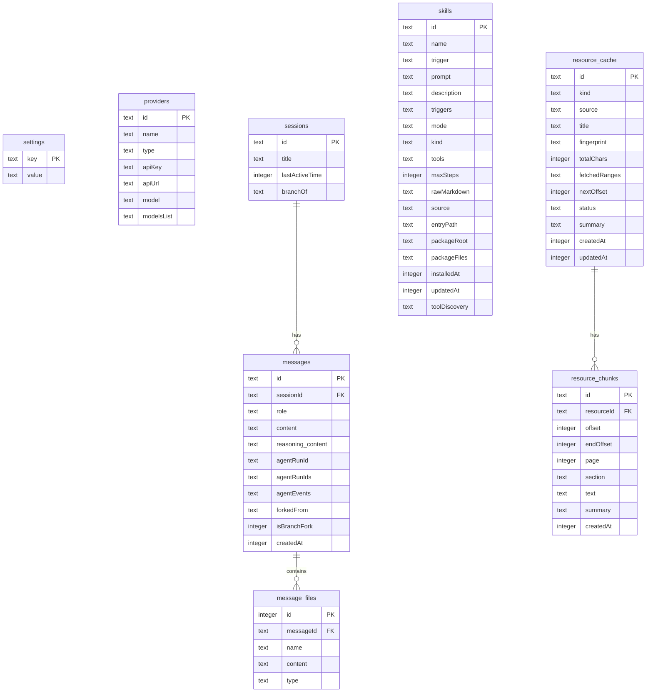

# QuickAI 技术架构文档

> 一个基于 Electron + React + TypeScript 的桌面 AI 助手应用，支持多服务商模型、分支与中断恢复的 ReAct Agent、持久化 SQLite 缓存和 Git 版本化的长期记忆系统。

---

## 目录

1. [项目概览与技术栈](#1-项目概览与技术栈)
2. [Electron 多进程与运行时环境](#2-electron-多进程与运行时环境)
3. [目录结构总览](#3-目录结构总览)
4. [持久化存储与数据库架构 (SQLite)](#4-持久化存储与数据库架构-sqlite)
5. [Git 长期记忆系统 (Durable Memory)](#5-git-长期记忆系统-durable-memory)
6. [模块化工具管理系统 (Dynamic Tools Registry)](#6-模块化工具管理系统-dynamic-tools-registry)
7. [分支与恢复的 Agent 执行引擎 (ReAct Loop)](#7-分支与恢复的-agent-执行引擎-react-loop)
8. [核心数据流与生命周期](#8-核心数据流与生命周期)
9. [Preload 桥接与安全模型](#9-preload-桥接与安全模型)
10. [Renderer 进程架构与 React Hooks 编排](#10-renderer-进程架构与-react-hooks-编排)
11. [IPC 通道设计与类型系统](#11-ipc-通道设计与类型系统)
12. [多层缓存体系](#12-多层缓存体系)
13. [系统安全模型与纵深防御](#13-系统安全模型与纵深防御)
14. [测试体系](#14-测试体系)

---

## 1. 项目概览与技术栈

QuickAI 是一个 **uTools 风格的桌面 AI 助手**，通过 `Alt+/` 全局快捷键在 Spotlight 风格的居中位置瞬间召唤/隐藏悬浮窗口。应用支持多种 AI 服务商（DeepSeek、Kimi/Moonshot、Ollama 本地部署等），并在底层构建了高度灵活的 ReAct 智能体（Agent）系统。

| 层级 | 技术 | 用途 |
| --- | --- | --- |
| **桌面容器** | Electron 39 | 窗口位置优化、系统托盘、全局快捷键、进程级隔离 |
| **构建工具** | electron-vite 5 | 统一 main/preload/renderer 三端的快速开发与打包 |
| **持久化层** | better-sqlite3 11 | 基于 SQLite 的关系型本地数据库，WAL 模式保障并发写入 |
| **长期记忆** | Git CLI + Markdown | 自动 Git 版本化的 Markdown 长期知识库 |
| **前端框架** | React 19 + TypeScript 5 | 渲染进程的响应式 UI 状态与事件响应 |
| **测试** | Vitest 4 | 支持 node 模拟及 Electron 环境 mock 的单元测试 |

---

## 2. Electron 多进程与运行时环境

应用采用 Electron 经典的多进程架构设计，将高风险的原生能力限制在主进程，渲染进程通过 Preload 层的沙箱接口进行隔离：

```
┌──────────────────────────────────────────────────────────┐
│                     Main Process (Node.js)               │
│                                                          │
│  ┌──────────────┐  ┌───────────────┐  ┌───────────────┐  │
│  │   index.ts   │  │  database.ts  │  │  agentLoop.ts │  │
│  │  窗口与托盘  │  │ SQLite 持久化 │  │   ReAct 核心  │  │
│  └──────┬───────┘  └───────────────┘  └───────┬───────┘  │
│         │                                     │          │
│  ┌──────▼───────┐  ┌───────────────┐  ┌───────▼───────┐  │
│  │   store.ts   │  │ toolRegistry  │  │  memoryStore  │  │
│  │  KV 存储适配 │  │  动态工具注册 │  │  Git-Markdown │  │
│  └──────────────┘  └───────────────┘  └───────────────┘  │
│                                                          │
│  ═══════════════ IPC Bridge ═══════════════              │
│         contextBridge.exposeInMainWorld                   │
│└─────────────────────────┬────────────────────────────────┘
                           │
                           │  ipcRenderer.invoke / .send / .on
                           │
┌──────────────────────────▼───────────────────────────────┐
│                    Preload Layer (Sandbox)               │
│  index.ts — 暴露 window.api 与 window.electron 对象      │
└──────────────────────────┬───────────────────────────────┘
                           │
                           │  window.api.*
                           │
┌──────────────────────────▼───────────────────────────────┐
│                  Renderer Process (React)                │
│                                                          │
│  ┌──────────────┐  ┌───────────────┐  ┌───────────────┐  │
│  │   App.tsx    │  │  chatStreaming│  │   components/ │  │
│  │ UI 布局与编排│  │ 前端流式解析器│  │  视图组件渲染 │  │
│  └──────┬───────┘  └───────────────┘  └───────────────┘  │
│         │                                                │
│  ┌──────▼───────┐  ┌───────────────┐  ┌───────────────┐  │
│  │  useSessions │  │ useAutocomplete│  │  useProviders │  │
│  │ 会话与分支管理│  │  命令自动补全  │  │ 服务商/API设置│  │
│  └──────────────┘  └───────────────┘  └───────────────┘  │
└──────────────────────────────────────────────────────────┘
```

---

## 3. 目录结构总览

```
src/
├── shared/                       # 三端共享的纯类型定义与接口声明
│   └── types.ts                  # 全局类型定义（AI配置、消息、事件流、Skill、存储模型）
├── preload/                      # 预加载脚本目录（沙箱桥接）
│   ├── index.ts                  # contextBridge API 暴露实现
│   └── index.d.ts                # window.api 接口类型声明
├── main/                         # Electron 主进程 (Node.js 运行时)
│   ├── index.ts                  # 应用入口：生命周期、托盘、窗口交互、IPC 事件分发与响应
│   ├── database.ts               # SQLite 数据库底层逻辑：建表、表迁移、数据 CRUD
│   ├── store.ts                  # 旧版 store 的适配层，封装 load/save 指导 SQLite 读写
│   ├── aiClient.ts               # Chat 模式入口，调用 LLM 完成无工具辅助的标准会话
│   ├── paths.ts                  # 集中管理 ~/.quickai 等本地目录及路径解析
│   ├── resourceCache.ts          # 网络内容抓取（fetch_url）的磁盘关系分块缓存与合并
│   ├── webTools.ts               # SSRF 防御的网络请求实现、网页 HTML 剥离、多引擎级联搜索
│   ├── logger.ts                 # 主进程文件和控制台日志记录器
│   ├── tools/                    # 模块化工具箱目录
│   │   ├── types.ts              # 工具定义接口及 API 转换声明
│   │   ├── registry.ts           # 动态工具注册中心，包括 Proxy 兼容代理
│   │   ├── helpers.ts            # 工具辅助逻辑：SSRF校验、沙箱判断、系统通知
│   │   ├── file.ts               # file_read, file_write, workspace_search, workspace_list_files
│   │   ├── web.ts                # fetch_url, web_search
│   │   ├── system.ts             # read_cached_resource, search_cached_resource, read_tool_output, task, inspect_environment, notify
│   │   ├── memory.ts             # list_past_actions, get_past_action, read_memory, list_memory, write_memory, delete_memory
│   │   └── shell.ts              # shell 执行工具（带超时与 Abort 信号检测）
│   ├── memory/                   # Durable Memory 逻辑层
│   │   ├── memoryStore.ts        # 针对 memories/ 目录下的 markdown 文件的操作和自动索引
│   │   └── memoryGit.ts          # Git CLI 的 programmatic 调用，用于变动自动 commit
│   └── agent/                    # Agent 引擎目录
│       ├── index.ts              # 引擎对外的统一导出入口
│       ├── AgentRunContext.ts    # Agent 运行时状态容器（工具列表、大输出临时存储等）
│       ├── agentLoop.ts          # Agent ReAct 循环主驱动器
│       ├── callModel.ts          # 兼容 OpenAI SSE 标准的 LLM 调用层（内置 <think> 标签解析）
│       ├── messageBuilder.ts     # 系统提示词编排、技能包装、资源覆盖摘要注入
│       ├── contextManager.ts     # 上下文窗口预算估算及两阶段智能截断机制
│       ├── permissionManager.ts  # 等待 UI 异步授权的 Promise 等待逻辑
│       ├── constitution.ts       # 静态规则库，根据工具入参和文件类型动态升级授权级别
│       ├── commandSafety.ts      # 纯词法分析的 Shell 命令及文件路径安全分类器
│       ├── loopGuard.ts          # 检测模型调用循环及连续工具失败自动 halt 阻断
│       ├── retryPolicy.ts        # 网络瞬态异常重试策略
│       ├── tokenEstimator.ts     # 离线 Token 开销估算器
│       ├── actionLog.ts          # 行动日志管理器（每会话 JSONL 读写，含脱敏逻辑）
│       ├── runCheckpoint.ts      # Agent 执行切片状态存档，用于故障恢复与分支追溯
│       └── runManifest.ts        # Agent 运行跟踪清单，登记已创建消息和副作用（Side Effects）
└── renderer/                     # Renderer 进程 (React 前端)
    └── src/
        ├── main.tsx              # React 挂载入口
        ├── App.tsx               # UI 状态机骨架与全局弹窗管理
        ├── hooks/                # 响应式逻辑 Hook
        │   ├── useSessions.ts    # 会话列表增删改查及缓存自动修剪
        │   ├── useChatCompletion.ts # 对话调度核心，支持常规对话、Skill运行、分支及恢复
        │   ├── useProviders.ts   # 多模型、服务商及工具权限配置管理
        │   ├── useSkills.ts      # Skill 的 markdown 导入与解析
        │   ├── useAutocomplete.ts # Spotlight 式快捷指令自动完成
        │   ├── useAttachments.ts # 前端粘贴/拖拽附件预处理
        │   ├── chatStreaming.ts  # 处理与 Preload `onChatChunk` 通信的前端逻辑封装
        │   ├── sessionBranching.ts # 创建分叉会话、提取运行轨迹等分支工具包
        │   └── chatMessageEvents.ts # 辅助消息渲染与行内恢复逻辑转换
        ├── components/           # UI 视图组件
        │   ├── MessageBubble.tsx # 单条消息气泡（含 Markdown 渲染、KaTeX、代码块、Agent 事件流及权限控制）
        │   ├── SettingsView.tsx  # 设置面板（服务商、模型选择、技能导入、权限审计）
        │   └── ...
        └── utils/
            ├── messageFormat.tsx # Markdown + KaTeX + Prism 代码高亮渲染器
            └── skillMarkdown.ts  # SKILL.md 声明格式解析器
```

---

## 4. 持久化存储与数据库架构 (SQLite)

在之前的版本中，QuickAI 使用 JSON 文件进行扁平化存储。现已全面重构成基于本地 SQLite 关系型数据库的架构。

### 4.1 核心数据库管理器 —— [database.ts](file:///d:/Git/Quick%20Ai/src/main/database.ts)

主进程首次初始化时，会在 `{userData}/quickai.db` 创建 SQLite 数据库并运行性能优化 Pragmas：
- **WAL 模式** (`journal_mode = WAL`)：允许并行读写，提升写入速度。
- **外键约束** (`foreign_keys = ON`)：启用层级级联删除（例如：删除 session 时自动删除其关联的 messages 和 message_files）。
- **同步级别** (`synchronous = NORMAL`)：降低写盘同步频率，减少磁盘 I/O 阻塞。

### 4.2 数据库 Schema 结构



### 4.3 JSON 数据自动迁移机制

如果数据库为空而本地存在旧格式的 `quickai_store.json` 与 `resources/` 目录，[database.ts](file:///d:/Git/Quick%20Ai/src/main/database.ts) 的 `migrateFromJson()` 会自动解析旧数据，通过批量准备语句 (Prepared Statements) 将数据转换并插入到 SQLite 对应的表中，成功后将旧的 JSON 文件重命名为 `.bak` 文件。

### 4.4 KV 桥接适配器 —— [store.ts](file:///d:/Git/Quick%20Ai/src/main/store.ts)

为了不破坏已有的 IPC 调用逻辑，[store.ts](file:///d:/Git/Quick%20Ai/src/main/store.ts) 导出了一个 `FileStore` 类，其 `get(key)` 和 `set(key, val)` 接口保持原样，但在内部透明地转换为调用 `database.ts` 中的 `loadSettings()`, `saveSettings()`, `loadSessions()`, `saveSessions()`, `loadSkills()`, `saveSkills()` 等关系型数据库读写逻辑。

---

## 5. Git 长期记忆系统 (Durable Memory)

为了防止模型会话因为上下文截断而丧失对全局背景、工作路径或用户核心偏好的认知，应用设计了独立于会话上下文的长期记忆系统。

### 5.1 记忆目录结构 (`~/.quickai/memories`)
长期记忆库由以下核心 Markdown 文件组成，由主进程的 [memoryStore.ts](file:///d:/Git/Quick%20Ai/src/main/memory/memoryStore.ts) 进行维护：

- `always.md` (常态注入内存)：每一轮任务都会强制拉取并拼接在系统提示词的最上方，适合记录全局安全边界、用户语言偏好。
- `memory_summary.md` (按需索引表)：保存由 MEMORY.md 的所有 `Task Group` 提取的条目目录。在任务初始化时会被注入到 System Prompt，告诉模型当前有哪些大记忆组可以调用。
- `MEMORY.md` (按需知识库)：按照 `# Task Group: <名称>` 进行段落划分的本地 Markdown 知识库。模型可以通过 `read_memory(target="xxx")` 按需提取。
- `raw_memories.md` (原始记忆沉淀)：追加写入的原始经验记录，供系统重建或审计。
- `rollout_summaries/` (任务轨迹追溯)：记录历史任务执行成功或失败的溯源日志（以日期-命名命名）。

### 5.2 自动 Git 版本化控制 —— [memoryGit.ts](file:///d:/Git/Quick%20Ai/src/main/memory/memoryGit.ts)

每次模型通过 `write_memory` 或 `delete_memory` 修改上述 Markdown 文件时，[memoryStore.ts](file:///d:/Git/Quick%20Ai/src/main/memory/memoryStore.ts) 会在写入完成后立即执行 Git 命令：
1. 检查本地 `.git` 目录是否存在。如果不存在则执行 `git init` 自动初始化仓库，并预置本地提交邮箱为 `memory@quickai.local`。
2. 调用 `git add -A` 暂存所有变化。
3. 调用 `git commit -m "memory: write task group ..."` 固化记录，确保每一次记忆改动都可查、可做差异分析 (Diff)、可做历史回滚。
4. **容错机制**：由于 Git 依赖于系统命令，如果用户机器未安装 Git 命令行工具，底层会自动退避为“无版本控制”的纯文件读写，保证记忆功能依旧可用。

---

## 6. 模块化工具管理系统 (Dynamic Tools Registry)

随着工具量级的提升，QuickAI 从早期单文件的硬编码注册升级为模块化、动态可插拔的工具设计。

### 6.1 工具定义规范 —— [types.ts](file:///d:/Git/Quick%20Ai/src/main/tools/types.ts)

每个工具都必须实现 `ToolDefinition` 接口：
```typescript
export interface ToolDefinition {
  name: string
  title: string
  description: string
  tags: string[]
  category: 'web' | 'file' | 'shell' | 'memory' | 'system'
  risk: 'low' | 'medium' | 'high'
  implemented: boolean
  discoverable: boolean
  parameters: {
    type: 'object'
    properties: Record<string, any>
    required?: string[]
  }
  execute: (args: ToolArgs, ctx: ToolExecutionContext) => Promise<{
    resultForModel: string
    resultForUi: ToolResultUi
  }>
}
```

### 6.2 动态工具注册中心 —— [registry.ts](file:///d:/Git/Quick%20Ai/src/main/tools/registry.ts)

工具模块放置在 `src/main/tools/` 下按类别解耦：
- `file.ts` (文件工具)：`file_read`, `file_write`, `workspace_search`, `workspace_list_files`
- `web.ts` (网页工具)：`fetch_url`, `web_search`
- `system.ts` (系统与任务)：`read_cached_resource`, `search_cached_resource`, `read_tool_output`, `task` (步骤追踪), `inspect_environment` (运行环境探测), `notify` (系统通知)
- `memory.ts` (记忆工具)：`read_memory`, `list_memory`, `write_memory`, `delete_memory`, `list_past_actions`, `get_past_action`
- `shell.ts` (脚本执行)：`shell`

主进程启动时会利用 `ToolRegistryImpl` 注册所有内置模块。
为了兼容旧版代码直接使用 `ToolRegistry[name]` 的 bracket 形式，[registry.ts](file:///d:/Git/Quick%20Ai/src/main/tools/registry.ts) 暴露了一个 Proxy 代理。当调用 `ToolRegistry[name]` 时，代理会将调用路由至 `ToolRegistryImpl.get(name)`。同时，它支持 `Object.keys()` 和 `for...in` 对动态加载的工具进行迭代。

---

## 7. 分支与恢复的 Agent 执行引擎 (ReAct Loop)

Agent 执行引擎在 ReAct 循环的基础上，新增了对会话中断（Interrupt）、切片保存（Checkpointing）、分支（Branching）和执行流复苏（Resuming）的完整支持。

### 7.1 Agent 切片与清单体系

当 Agent 模式被触发时，除了标准的 ReAct 状态维护，以下两套数据结构会被持久化保存：

#### 1. 运行时切片 —— [runCheckpoint.ts](file:///d:/Git/Quick%20Ai/src/main/agent/runCheckpoint.ts)
切片保存了单步执行完毕时的全部关键数据。在主循环的每个 Turn 结束、发送完响应、执行完工具后，引擎会将其写入到磁盘文件：`{userData}/run_checkpoints/{sessionId}/{reqId}.json`。
```typescript
export interface RunCheckpoint {
  version: number
  sessionId: string     // 关联会话ID
  reqId: string         // 关联运行ID
  updatedAt: number
  step: number          // 当前执行的步数
  messages: ChatCompletionMessage[] // 当前全量历史消息
  activeTools: string[] // 当前已发现激活的工具
  lastCompletedCallId?: string
  ambiguousActions?: AmbiguousAction[] // 存留的执行状态模糊的动作
}
```

#### 2. 执行清单 —— [runManifest.ts](file:///d:/Git/Quick%20Ai/src/main/agent/runManifest.ts)
清单记录了一个运行过程中的追踪信息，存盘路径为 `{userData}/run_manifests/{sessionId}/{reqId}.json`：
```typescript
export interface AgentRunManifest {
  version: number
  runId: string
  sessionId: string
  sourceMessageId?: string      // 触发该 Run 的 User 消息 ID
  assistantMessageId?: string   // 本次 Run 写入的 Assistant 消息 ID
  parentRunId?: string          // 如果是 Resume，父级 Run 的 ID
  branchOf?: { sessionId: string; messageId: string; runId?: string } // 分支来源
  status: 'running' | 'completed' | 'failed' | 'cancelled' | 'max_steps'
  actionCallIds: string[]       // 调用过的所有 action id 列表
  resourceIds: string[]         // 涉及的全部 fetched 网页缓存ID
  sideEffects: SideEffectEntry[] // 发生的副作用列表（如文件写入、shell执行）
}
```

### 7.2 中断与在线恢复机制 (Resume Mode)

当 Agent 由于异常（如网络瞬时中断、大模型 API 限流、连续失败过长或执行超时）停顿，UI 会将错误记录渲染在气泡尾部，并显示 **“恢复（Resume）”** 按钮。
1. 用户点击恢复后，前端获取该步骤消息中的 `agentRunId` (即原先的 `reqId`)。
2. 前端向主进程发送 `start-chat-completion` 并带上 `resumeFromRunId`。
3. 主进程的 [agentLoop.ts](file:///d:/Git/Quick%20Ai/src/main/agent/agentLoop.ts) 拦截此恢复信号，调用 `loadRunCheckpoint()` 装载之前的内存切片，将执行步数还原到中断点。
4. 为了提示大模型，主进程构建一段 `RESUME MODE` 系统上下文指令（[resumePrompts.ts](file:///d:/Git/Quick%20Ai/src/main/agent/resumePrompts.ts)），指出这是一次自动恢复：
   ```text
   [RESUME MODE]
   This is an automatic continuation of the same agent task after a previous execution failure.
   No new user request was added. Continue the original task from the completed tool observations...
   Resuming from run: <originalReqId>
   Checkpoint step: <step>
   ```
5. 模型不需要重新开始或者盲目重复副作用工具（如写入），而是可以直接衔接历史 Observations 继续思考。

### 7.3 会话分支派生与重构 (Session Branching)

当用户在会话的历史记录上进行 **编辑并保存**，或者针对历史旧消息点击 **重新生成** 时，QuickAI 会启动会话分支分叉机制：

1. **状态复制与分叉**：
   - 渲染进程通过 [sessionBranching.ts](file:///d:/Git/Quick%20Ai/src/renderer/src/hooks/sessionBranching.ts) 创建一个全新的 Session（分叉会话），并为它打上 `branchOf` 标识（记录父会话 ID、对应的分支消息 ID 以及触发 Run 的 ID）。
   - 将原会话中截至该消息为止的历史记录克隆到新会话，并将编辑后的内容作为最新的 User 消息。
   - 新建一个 Assistant 消息占位，然后切换活跃会话 ID，使 UI 瞬间无缝切换到新会话窗口。

2. **持久化缓存分叉 (Fork Caches)**：
   - 主进程收到 IPC 调用的 `fork-session-caches` 请求。
   - 引擎提取父会话在该编辑消息之前生成的所有 Agent Run 历史 ID。
   - 主进程自动将这些 Run 的 `actionLog` 追加记录拷贝到新会话的日志中。
   - 同时，它会执行文件系统克隆，将父会话在该点之前的 `runCheckpoint` 和 `runManifest` 文件成套拷贝到新会话目录。
   - 结果是，分叉出来的分支会话完美地继承了历史的行动轨迹。在继续对分支会话调用 `list_past_actions` 时，模型依然能获得此前在父会话中执行过的工具记录，防止在分支会话中做重复的网络拉取或操作。

---

## 8. 核心数据流与生命周期

以下是用户触发 Agent 或常规 Chat 到流式输出完毕的典型链路图：

```
                    Renderer 进程                           Main 进程
                      
用户点击发送 ───────────────────────────────┐
  │                                         │
  ▼                                         │
App.tsx: handleSendMessage()                │
  │                                         │
  ├─ 检查运行模式 (RunMode: chat/agent)        │
  ├─ [分支模式检测] ─ 触发?                   │
  │     └─ YES: 创建新 Session (branchOf)    │
  │             调用 forkSessionCaches()  ──┼──────────────────┐
  │             切换活跃会话为新分支        │                  │
  ├─ 渲染 User 消息及 Assistant 占位气泡       │                  │
  └─ 调用 window.api.startChatCompletion() ─┼────────┐         │
                                            │        │         │
                                            │        ▼         │
                                            │  index.ts        │
                                            │    │             │
                                            │    ├─ fork 逻辑 ─┼─── 复制 checkpoints
                                            │    │             │    及行动日志
                                            │    ▼             │
                                            │  agentLoop.ts    │
                                            │    │             │
                                            │    ├─ loadCheckpoint (如果是 Resume)
                                            │    ├─ 评估静态+动态权限
                                            │    ├─ 离线 Trim 消息适配 Context size
                                            │    │             │
                                            │    ▼             │
                                            │  [ReAct 循环] ◄──┐
                                            │    │             │
                                            │    ├─ callModel() (流式解析 SSE + <think>)
                                            │    │  ├─ reasoning ──► 抛出 chat-chunk
                                            │    │  └─ final ──────► 抛出 chat-chunk
                                            │    │             │
                                            │    ├─ prepareToolCalls()
                                            │    │  ├─ blocked ───► 直接返回报错/死锁
                                            │    │  ├─ direct ────► 并发执行
                                            │    │  └─ ask ───────► 阻断, 发送权限请求 ──┐
                                            │    │                                      │
                                            │    ├─ persistCheckpoint()                 │
                                            │    └─ 检查熔断或 maxSteps -> 结束          │
                                            │                                           │
                                            │◄──────────────────────────────────────────┘
  ┌─ 渲染 reasoning 实时思考段落               │ (主进程 Promise 等待 UI 响应)
  ├─ 渲染 final 流式输出内容                   │
  └─ [收到 tool_call 等待授权事件]            │
       │                                    │
       ▼                                    │
App.tsx: 弹出权限操作抽屉                     │
       │                                    │
       ├─ 用户点击“允许/拒绝”                 │
       └─ window.api.respondToolPermission()─┼───────► resolve() 挂起的 Promise
                                                       │
                                                       ▼
                                                     恢复工具执行，进入下一步
```

---

## 9. Preload 桥接与安全模型

Preload 层 ([index.ts](file:///d:/Git/Quick%20Ai/src/preload/index.ts)) 在保持严格沙箱特性的前提下，暴露出有限的系统级操作权限。

### 9.1 全局暴露接口

`window.api` 暴露的方法清单及其实际功能：
- `storeGet(key)` / `storeSet(key, value)`：进行 KV 格式配置、会话信息的存储交互。使用白名单过滤，只允许写入 `sessions`、`settings`、`skills` 键值。
- `getAppInfo()`：获取持久化数据库文件物理路径和当前应用版本号。
- `hideWindow()` / `reSummonWindow()`：控制窗口的折叠和唤醒。
- `setFilePickerActive(active)`：文件对话框打开时屏蔽 blur 自动隐藏。
- `setWindowPinned(pinned)`：窗口置顶/取消置顶控制。
- `startChatCompletion(reqId, options)`：向主进程发出会话请求。
- `startAgentSkill(reqId, options)`：以 Skill 模块注入系统提示词的形式触发 Agent 请求。
- `respondToolPermission(reqId, callId, approved)`：将权限确认的结果反馈给等待中的 Promise 授权机制。
- `abortGeneration(reqId)`：中止特定请求。
- `clearSessionCaches(payload)`：批量清理特定会话的 action log、切片文件以及无其他会话引用的“孤儿”网页缓存。
- `forkSessionCaches(payload)`：复制特定 Runs 历史的执行缓存到分支会话。
- `onChatChunk(callback)`：流式通道订阅。返回一个 `unsubscribe` 清理函数。
- `showNotification(title, body)`：触发系统通知。
- `listMemoryEntries()` / `readMemoryEntry(id)` / `writeMemoryEntry(id, content)`：提供给前端记忆管理面板读写长期记忆 Markdown 的底层支持。

---

## 10. Renderer 进程架构与 React Hooks 编排

前端完全基于 React 函数式组件及模块化 Hooks 架构构建，将页面状态编排和副作用逻辑进行了清晰的分离。

### 10.1 顶层状态调度中心 —— [App.tsx](file:///d:/Git/Quick%20Ai/src/renderer/src/App.tsx)

`App.tsx` 整合了五大领域 Hooks 导出的业务状态和事件处理器：

```
                      App.tsx
                         │
        ┌──────────┬─────┴────┬──────────┐
        │          │          │          │
        ▼          ▼          ▼          ▼
   useProviders useSessions useSkills useAttachments
        │          │          │          │
        └──────────┼──────────┼──────────┘
                   ▼
           useChatCompletion
```

### 10.2 领域 Hooks 设计

- [useProviders.ts](file:///d:/Git/Quick%20Ai/src/renderer/src/hooks/useProviders.ts) (服务商管理)：
  - 绑定 SQLite 中 `settings` 表的数据，控制全局 API url、Key 的维护。
  - 获取各服务商下的模型列表，控制工具的全局开关及默认静态权限（allow/ask/deny）。
  
- [useSessions.ts](file:///d:/Git/Quick%20Ai/src/renderer/src/hooks/useSessions.ts) (多会话维护)：
  - 管理左侧会话历史的 CRUD。
  - 维护 5 分钟超时机制：当窗口重新聚焦且活跃会话的最后一次活动时间超出 5 分钟，会自动创建一个新的“新对话”会话，防止会话上下文过长降低效率。
  - **孤儿资源修剪**：当删除某会话或执行 clear 时，该 Hook 导出的 `computeResourcePrune()` 会在前端计算出**仅由当前被清理会话引用，而未被其他存活会话引用**的所有 `resourceId` 列表，然后发送 `clearSessionCaches` 彻底移出磁盘。

- [useChatCompletion.ts](file:///d:/Git/Quick%20Ai/src/renderer/src/hooks/useChatCompletion.ts) (生成流调度)：
  - 会话消息流的拼装点。
  - 汇聚了正常发送、技能启动、单条消息中途编辑分叉（[sessionBranching.ts](file:///d:/Git/Quick%20Ai/src/renderer/src/hooks/sessionBranching.ts)）、单步故障恢复（Inline Resume）的调度入口。

- [useAutocomplete.ts](file:///d:/Git/Quick%20Ai/src/renderer/src/hooks/useAutocomplete.ts) (补全系统)：
  - 监控输入框字符，如果以 `/`、`#`、`@` 开头，会检索内置命令、会话、服务商和技能别名，返回高可用的补全面板列表。

---

## 11. IPC 通道设计与类型系统

应用通过严格的 TypeScript 契约统一约束前端和主进程之间的交互参数。所有的接口实体均放置在 [types.ts](file:///d:/Git/Quick%20Ai/src/shared/types.ts) 共享模块下。

### 11.1 IPC 接口全景表

| 模式 | 通道名称 | 传参 | 返回值 | 职责描述 |
| --- | --- | --- | --- | --- |
| **Invoke** | `store-get` | `key: StoreKey` | `StoreValue` | 读取 store 允许白名单内的配置数据 |
| **Invoke** | `store-set` | `key, value` | `boolean` | 写入 store 允许配置 |
| **Invoke** | `get-app-info` | 无 | `{ storePath, version }` | 返回物理存储路径 |
| **Invoke** | `clear-session-caches` | `ClearSessionCachesPayload` | `{ ok: true }` | 物理清除磁盘日志及孤立缓存 |
| **Invoke** | `fork-session-caches` | `ForkSessionCachesPayload` | `{ ok, actions... }` | 分叉会话时拷贝之前的运行缓存 |
| **Invoke** | `fetch-models` | `apiUrl, apiKey` | `string[]` | 动态连网请求服务商模型列表 |
| **Invoke** | `memory-entries` | 无 | `MemoryEntry[]` | 返回全部长期记忆文件描述 |
| **Invoke** | `memory-entry-read` | `id: string` | `string` | 读特定长期记忆内容 |
| **Invoke** | `memory-entry-write`| `id, content` | `{ ok: true }` | 更新特定长期记忆文件内容并执行 Git 提交 |
| **Send** | `hide-window` | 无 | 无 | 隐藏悬浮框 |
| **Send** | `set-file-picker-active` | `active: boolean` | 无 | 防止系统选择文件时失焦折叠窗口 |
| **Send** | `set-window-pinned` | `pinned: boolean` | 无 | 置顶悬浮框 |
| **Send** | `re-summon-window` | 无 | 无 | 强制重新唤醒窗口 |
| **Send** | `toggle-devtools` | 无 | 无 | 切换控制台面板 |
| **Send** | `show-notification` | `title, body` | 无 | 发送系统桌面横幅通知 |
| **Send** | `start-chat-completion` | `reqId, ChatRunOptions` | 无 | 启动对话流（包括 Agent 与 Chat） |
| **Send** | `start-agent-skill` | `reqId, AgentSkillRunOptions` | 无 | 启动特定 Agent 技能运行 |
| **Send** | `respond-tool-permission`| `reqId, callId, approved` | 无 | 反馈安全确认响应 |
| **Send** | `abort-generation` | `reqId` | 无 | 中断该次生成 |

---

## 12. 多层缓存体系

QuickAI 建立了四层多级缓存结构，分工明确，保障性能与安全：

| 缓存类型 | 存储位置 | 生命周期 | 淘汰策略 | 清理时机 | 功能目的 |
| --- | --- | --- | --- | --- | --- |
| **ActionLog** | `{userData}/action_logs/{sessionId}.jsonl` | 跨会话持久化 | 最多 500 条 | 会话清除 / 删除时物理移出磁盘 | 供 Agent 使用 `list_past_actions` 查询历史工具行动轨迹，支持参数脱敏 |
| **ResourceCache** | SQLite (`resource_cache` / `resource_chunks`) | 跨会话共享持久化 | 字符数超出 2MB 则淘汰旧 chunk | 当前会话被清理且该资源不被其他存活会话引用 (Orphan Pruning) | 对 `fetch_url` 网页抓取的大数据量文本分块索引，支持分页重读 |
| **ToolOutputStore** | 内存 Map ([AgentRunContext.ts](file:///d:/Git/Quick%20Ai/src/main/agent/AgentRunContext.ts)) | Run 级别（临时） | 最大 5MB | 运行退出/销毁时释放内存 | 临时缓存超出 2000 字符的巨量工具输出，防止在 Trim 时永久丢失 |
| **RunCheckpoint** | `{userData}/run_checkpoints/{sessionId}/{reqId}.json` | Run 级别（半持久） | 无 | 关联会话删除或清理时 | 存储单 Turn 的执行切片消息，为 Resume 中断恢复提供基准数据 |

---

## 13. 系统安全模型与纵深防御

作为一个拥有本地磁盘文件读写和 Shell 命令执行能力的 Agent 系统，应用采用了多层纵深安全机制。

### 13.1 权限过滤宪法 —— [constitution.ts](file:///d:/Git/Quick%20Ai/src/main/agent/constitution.ts)

每次工具执行前，`evaluateToolGuard()` 会联合 [commandSafety.ts](file:///d:/Git/Quick%20Ai/src/main/agent/commandSafety.ts) 进行参数级的静态分析与权限**动态升级（Escalation）**：
- **越狱逃逸防御**：检查输入的文件路径中是否包含 `..` 遍历、绝对路径、用户根目录 `~` 或系统环境变量（`$HOME`）。一旦发现有逃逸 Workspace (`~/quickai/`) 的企图，权限动态强制更改为 `deny` 并直接阻断执行。
- **敏感文件拦截**：如果检测到文件路径中包含 `.env`、`id_rsa`、`.pem`、`.key`、`.git`、`id_ecdsa` 等潜在敏感信息文件，将自动把原本处于 `allow` 的读取权限升级为 `ask`（弹窗强阻断，必须用户手动点击确认）。
- **Shell 命令风险评级**：
  - `dangerous` (高危，强制 `deny` 拦截)：包含 `rm -rf` 系统路径、`mkfs`、`dd`、`shutdown`、多命令拼装 (分号/管道) 等。
  - `requires_approval` (需授权，强制 `ask`)：未知命令或普通的 `rm` 操作等。
  - `safe` (安全，执行)：`ls`、`cat`、`grep`、`pwd` 等只读与无副作用命令。

### 13.2 运行时行为保护 (LoopGuard & SSRF)

- **LoopGuard (死循环熔断)**：[loopGuard.ts](file:///d:/Git/Quick%20Ai/src/main/agent/loopGuard.ts) 会将工具调用的入参计算稳定哈希。如果发现模型对同名工具及相同参数发起大于等于 3 次的重复调用，会直接阻断并返回提示。如果同一个工具连续报错发生大于等于 8 次，将强行熔断并迫使模型进入 Final Answer，防止 API 被无限循环调用刷爆。
- **SSRF 拦截**：[webTools.ts](file:///d:/Git/Quick%20Ai/src/main/webTools.ts) 在发起网页抓取请求时，会首先进行 DNS 预解析，检查解析出的 IP 是否命中内网私有网段（如 `127.0.0.1`、`192.168.x.x` 等）。如果是，则直接阻断以避免恶意网页利用 Agent 进行内网刺探或内网服务重定向攻击。
- **ActionLog 数据脱敏**：[actionLog.ts](file:///d:/Git/Quick%20Ai/src/main/agent/actionLog.ts) 在写盘或输出时，使用脱敏机制，发现 `apiKey`、`secret`、`password` 等敏感参数键时自动以 `[redacted]` 填充，避免 API 密钥以明文形式泄露在日志文件中。

---

## 14. 测试体系

应用基于 **Vitest 4** 框架搭建了完善的测试体系，重点覆盖逻辑复杂的 Agent 循环、数据库迁移以及安全卫士模块。

### 14.1 核心测试用例分类

| 测试类 | 测试文件 | 测试的核心边界 |
| --- | --- | --- |
| **数据库/持久化** | `database.ts` | SQLite 结构校验、自动迁移合并逻辑测试、外键及级联删除校验 |
| **Agent 执行** | `agentLoop.test.ts` | 步数上限控制、故障中断与恢复测试、分支轨迹隔离与重载测试 |
| **行动日志管理** | `actionLog.test.ts` | JSONL 读写速度测试、敏感密钥过滤红线校验、FIFO 内存溢出测试 |
| **安全宪法守卫** | `constitution.test.ts` | 逃逸路径拦截率、敏感配置读取拦截、高危 shell 命令评估准确度 |
| **LoopGuard 熔断** | `loopGuard.test.ts` | 循环哈希防重放机制、最大重试次数阶梯警告、失败阈值halt截断 |
| **SSRF 网络防护** | `webTools.test.ts` | 本地回环地址拦截效果、重定向追溯检查、级联搜索引擎切换逻辑 |
| **消息裁剪机制** | `contextManager.test.ts`| 两阶段裁剪中大工具输出转换为 retrievable pointer 效果、旧消息整组裁剪 |
